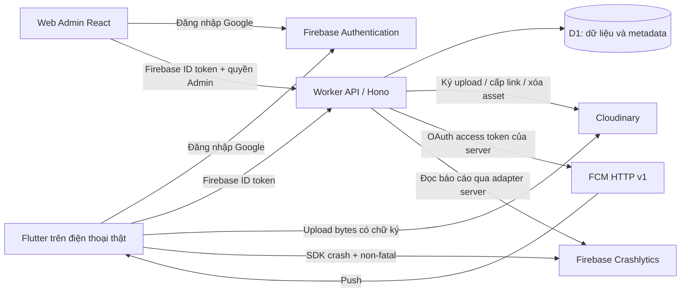

# Kế hoạch backend Longevity Plate - Assignment 3

Ngày lập: 13/11/2026. Nền mã: nhánh `feature/meal-photo-local-cloudinary-plan`, commit `56bce85` và tài liệu local hiện có. Đây là thiết kế triển khai; không phải xác nhận backend đã deploy.

## 1. Quyết định đề xuất

Phát triển tiếp backend đang có trong `server/`, dùng **Cloudflare Workers + TypeScript + Hono + Cloudflare D1**. Firebase Authentication tiếp tục quản lý đăng nhập Google; Cloudinary lưu ảnh/PDF; FCM gửi thông báo; Firebase Analytics, Crashlytics và Remote Config giữ vai trò hiện tại. Xây một **web Admin React + Vite** dùng chung backend.

Cloudflare D1 là database nghiệp vụ dùng chung cho mobile và Admin. Cloudinary chỉ lưu tệp. SharedPreferences/file local trên Flutter trở thành cache và hàng đợi đồng bộ. Không tạo hệ thống mật khẩu hoặc JWT riêng song song với Firebase Auth.

Tổ chức theo một ứng dụng backend có các module, không cần microservice. Dùng SQL migration và prepared statements trực tiếp cho D1 ở bản đầu; chưa cần ORM.

Lý do lựa chọn:

- Repo đã có Worker kiểm tra Firebase ID token và ký upload PDF; giữ được phần đã có test.
- Có nơi lưu bữa ăn, thiết bị, lịch sử gửi và metadata ảnh để Admin truy vấn; không phải dùng Cloudinary như database.
- Mobile và Admin dùng cùng hợp đồng API, cùng quy tắc quyền theo UID.
- Workers và D1 có gói Free với quota; thiết kế demo trong quota, không mặc định bật Firebase Blaze, Workers Paid hoặc dịch vụ có thu phí để chạy.
- TypeScript giúp định nghĩa dữ liệu/API; Hono hỗ trợ môi trường Workers và middleware; Admin React có thể phục vụ qua Workers Static Assets.

## 2. Hiện trạng và phạm vi

Trong repo đã có source backend nhỏ `server/src/index.js` với hai endpoint `/reports/sign` và `/reports/url`, xác minh Firebase ID token và ký Cloudinary. Người dùng chưa triển khai backend thật. Không đồng nhất việc có file source với việc có URL API đang chạy.

| Module | Hiện có | Mục tiêu backend |
|---|---|---|
| Authentication | Firebase Google Sign-In trong Flutter; Worker kiểm tra token | Middleware chung, API người dùng hiện tại, quyền Admin |
| Bữa ăn/ảnh | SharedPreferences và file JPEG riêng theo UID | Lưu bữa lên D1, signed upload ảnh, metadata và quyền sở hữu |
| Mục tiêu/kế hoạch | Local theo UID | API đọc/ghi; đồng bộ giữa các lần đăng nhập/thiết bị |
| PDF | Source Worker và Flutter adapter Cloudinary | Deploy thật, giữ API cũ, metadata/lịch sử báo cáo |
| FCM | Client nhận tin, xin quyền, đọc token | Đăng ký thiết bị, Admin gửi tin, lịch sử và trạng thái gửi |
| Crashlytics | SDK fatal/non-fatal, user ID, key route, nút crash | Backend đọc dữ liệu Firebase; web Admin xem báo cáo thật |
| Analytics/Remote Config | SDK và adapter trong Flutter | Giữ SDK; giải thích/bằng chứng Lab3; chưa xây lại Console |
| Web Admin | Chưa có module riêng | Đăng nhập Admin, dashboard, thiết bị/thông báo, tệp và Crashlytics |

**Phạm vi tối thiểu cho Lab3:** xác thực API, phân quyền Admin, PDF riêng theo UID, đăng ký thiết bị/gửi FCM và Admin xem Crashlytics thật. Ảnh bữa ăn và đồng bộ database là phạm vi sản phẩm người dùng đã yêu cầu; thực hiện tiếp trên cùng nền, không thay thế luồng PDF trong bài.

## 3. Kiến trúc đích



- Browser Admin chỉ nhận dữ liệu nghiệp vụ được phép; không nhận Google service-account private key, OAuth access token của server hoặc Cloudinary API secret.
- Bản đầu dùng cùng origin cho Admin và API. Route `/api/*`, `/reports/*` phải chạy qua Worker; không để SPA fallback biến API lỗi thành HTML 200.
- Mobile vẫn dùng SDK Firebase cho Auth, FCM nhận tin, Analytics, Crashlytics và Remote Config. View không gọi trực tiếp SDK hay HTTP.

## 4. Quy tắc xác thực và quyền

### Firebase ID token

1. Flutter/React đăng nhập Google bằng Firebase SDK.
2. Client lấy Firebase ID token và gửi `Authorization: Bearer <token>`.
3. Worker kiểm tra chữ ký Google và các claim: thuật toán, kid, issuer, audience, thời hạn, subject, iat/auth_time và định dạng UID.
4. Context request chỉ lấy UID từ token đã xác minh. Client không được chọn chủ sở hữu bằng `body.uid`.
5. Chuẩn hóa lỗi: 401 chưa xác thực/token sai; 403 có danh tính nhưng thiếu quyền; 404 tài nguyên của chủ khác ở API nghiệp vụ để hạn chế dò ID.

### Quyền Admin

- D1 có `admin_users` chứa UID được cấp quyền. Seed qua lệnh triển khai đáng tin cậy, không có endpoint công khai tự nâng quyền.
- Middleware Admin xác thực token, tra UID có quyền hoạt động và kiểm tra quyền cho từng API.
- Không dùng email do client gửi hoặc cờ `isAdmin` trong localStorage để quyết định quyền.
- Thay đổi allowlist có hiệu lực ở backend; ghi nhật ký thao tác gửi FCM, xem/tải tệp và thao tác quản trị.
- Không cấp quyền cho mọi tài khoản Google. Đăng nhập thành công nhưng không thuộc allowlist thì web hiện trang từ chối truy cập.
- Admin xem nhật ký/bữa ảnh người dùng chỉ khi nằm trong quyền được xác định rõ; quyền tối thiểu Lab3 tập trung thông báo và báo cáo sự cố.

### Ba loại token cần giải thích khi báo cáo

| Loại | Nơi cấp | Dùng để làm gì |
|---|---|---|
| Firebase ID token | Firebase Auth | Chứng minh người gọi API là ai |
| FCM registration token | Firebase Messaging SDK/FCM | Địa chỉ nhận push của một bản cài app; không chứng minh danh tính |
| Google OAuth access token | Google OAuth cho danh tính server | Cho phép backend gọi FCM/Crashlytics theo IAM |

Không dùng lẫn ba loại token. Không lưu token dài hạn trong log hoặc slide.

## 5. Database D1

Các ID do client tạo phải là UUID/ID ổn định, được validate. Timestamp cập nhật do server cấp; ngày bữa ăn lưu `YYYY-MM-DD` theo lịch người dùng, không tự đổi ngày bữa bằng UTC.

| Bảng | Dữ liệu chính | Ràng buộc/index |
|---|---|---|
| `users` | Firebase UID, created_at, onboarded_at, timezone | PK uid; hạn chế lưu PII không cần thiết |
| `user_goals` | uid, goal | UNIQUE(uid, goal); goal thuộc enum hiện có |
| `meals` | id, uid, date, meal_type, description, photo_asset_id, version, deleted_at | UNIQUE(uid,id); index(uid,date,id); mô tả 1-120 ký tự |
| `plans` | uid, date, slot, recipe_id, version, deleted_at | UNIQUE(uid,date,slot); index(uid,date); recipe hợp lệ |
| `assets` | id, uid, kind, public_id, version, bytes, width, height, sha256, status | public_id unique; UNIQUE(uid,id); index(uid,kind,status) |
| `upload_sessions` | id, uid, asset_id, expires_at, status | Index(uid,status); loại ảnh/PDF và params được server chốt |
| `devices` | installation_id, uid, fcm_token, token_generation, platform, app_version, active, last_seen | Token active unique; index(uid,active); ràng buộc ownership |
| `push_jobs` | id, actor_uid, target_uid, title, body, route, request_key, status | request_key unique theo actor; payload có giới hạn |
| `notifications` | id, uid, job_id, message_id, title, body, route, accepted_at, opened_at | UNIQUE(uid,id); index(uid,created_at,id) |
| `admin_users` | uid, role, active, created_at | PK uid; chỉ seed/cập nhật từ luồng quản trị tin cậy |
| `crash_snapshots` | id, project_id, app_id, fetched_at, filter_json, source_version, payload_json | Index(app_id,fetched_at); payload đã lọc dữ liệu |
| `audit_logs` | actor_uid, action, target_type, target_id, request_id, timestamp, result | Index(timestamp,actor_uid); không chứa token/secret |
| `maintenance_jobs` | id, kind, target_id, run_after, status, attempts, lease_until | Dọn asset/tombstone, retry có giới hạn |

- Ràng buộc quan hệ asset - meal phải kiểm tra đồng thời UID và asset ID, không chỉ kiểm tra asset tồn tại.
- D1 transaction/batch chỉ bao phủ thao tác D1; upload Cloudinary hoặc gửi FCM không nằm trong transaction này.
- Không lưu bytes ảnh/PDF hoặc base64 file trong D1; chỉ lưu metadata và danh tính asset.
- Phân trang theo cursor ổn định, có giới hạn số bản ghi; tránh quét toàn bộ table ở dashboard.
- Chỉ thêm bảng idempotency riêng khi hợp đồng request thực sự cần; bản đầu ưu tiên ID ổn định và unique constraints theo owner.

## 6. API dự kiến

Base mới: `/api/v1`. Giữ `/reports/sign` và `/reports/url` làm compatibility adapter để không làm hỏng app/test hiện tại.

### Mobile

| Method / route | Chức năng | Điều kiện |
|---|---|---|
| `GET /health` | Liveness công khai, không lộ secret | Không trả stack/config |
| `GET /api/v1/me` | Profile và quyền của session hiện tại | Firebase token |
| `PUT /api/v1/me/goals` | Lưu mục tiêu/onboarding | Enum hợp lệ |
| `GET /api/v1/me/goals` | Đọc mục tiêu | Owner |
| `GET /api/v1/meals?from=&to=&cursor=` | Nhật ký theo khoảng ngày | Owner, bounded range |
| `PUT /api/v1/meals/:id` | Tạo/lưu bữa bằng ID ổn định | Owner; version nếu cập nhật |
| `DELETE /api/v1/meals/:id` | Đánh dấu xóa và tạo job dọn ảnh | Owner; tombstone |
| `GET /api/v1/plans?from=&to=` | Kế hoạch tuần | Owner |
| `PUT /api/v1/plans/:date/:slot` | Thêm/thay món | Recipe/slot hợp lệ, version |
| `DELETE /api/v1/plans/:date/:slot` | Bỏ món | Owner, version |
| `POST /api/v1/media/sign` | Xin chữ ký ảnh/PDF đã whitelist | Token; owner/asset do server xác định |
| `POST /api/v1/media/:assetId/complete` | Xác nhận asset thật, metadata | Owner; kiểm tra receipt/Cloudinary |
| `POST /api/v1/media/:assetId/url` | Link tải có hạn | Owner, hoặc Admin có quyền tương ứng |
| `POST /api/v1/devices/register` | Gắn token với bản cài và UID | Owner; generation chống request cũ |
| `POST /api/v1/devices/unregister` | Ngắt binding của session/bản cài | Không xóa binding mới của UID khác |
| `GET /api/v1/notifications?cursor=` | Lịch sử trên cloud | Owner |
| `POST /api/v1/notifications/:id/open` | Đánh dấu mở | Owner; idempotent |
| `GET /api/v1/reports?cursor=` | Lịch sử PDF của user | Owner |

### Admin

| Method / route | Chức năng |
|---|---|
| `GET /api/v1/admin/overview` | Tổng hợp số liệu có phạm vi và nguồn rõ ràng |
| `GET /api/v1/admin/devices` | Thiết bị hoạt động; che registration token trong list |
| `POST /api/v1/admin/push` | Gửi thông báo theo user/thiết bị được phép |
| `GET /api/v1/admin/push-jobs` | Lịch sử gửi, lỗi FCM, request ID |
| `GET /api/v1/admin/reports` | Metadata PDF theo quyền Admin |
| `GET /api/v1/admin/crashlytics/issues` | Tổng hợp issue fatal/non-fatal, bộ lọc app/version/time |
| `GET /api/v1/admin/crashlytics/issues/:id` | Chi tiết issue và event đã lọc |
| `POST /api/v1/admin/crashlytics/refresh` | Đọc/sync từ nguồn Firebase, có rate limit/cache |
| `GET /api/v1/admin/audit-logs` | Nhật ký thao tác quản trị |

`PUT` dùng ID ổn định để retry tạo không nhân bản. Lần tạo và lần cập nhật có hợp đồng version rõ ràng; cùng version nhưng body khác trả 409. API không tự ghi đè cập nhật của thiết bị khác.

Định dạng lỗi chung: `{ error: { code, message, requestId, retryable } }`. Response JSON chỉ xuất các trường cần cho client; lỗi bên ngoài được ánh xạ, không trả private key, stack hoặc raw provider response nhạy cảm.

## 7. Luồng bữa ăn và upload ảnh

1. Flutter chụp/chọn, normalize JPEG, giữ file local theo UID; tạo `mealId` một lần.
2. Lưu bữa và trạng thái pending local để không phụ thuộc mạng. Khi online, upsert metadata bữa lên API.
3. Backend tạo asset/upload session cho bữa thuộc UID đang đăng nhập; `publicId` ổn định như `meal_photos/<uid>/<mealId>/<sha256>`.
4. Client xin chữ ký rồi gửi JPEG trực tiếp lên Cloudinary. Type `authenticated`, allowed format JPG, không cho overwrite tùy ý.
5. Client gọi complete; server kiểm tra asset thuộc session, xác minh receipt đúng thuật toán và đối soát metadata từ Cloudinary khi cần. Không tin `secure_url`, bytes/width/height chỉ do client khai.
6. Backend gắn asset vào meal bằng thao tác D1 nhất quán. UI đổi badge riêng từ chờ tải sang đã tải ảnh.
7. Thiếu file local thì client xin URL mới và tải về cache riêng UID; không lấy URL có chữ ký hết hạn làm ID dài hạn của ảnh.

Các tình huống phải xử lý:

- Giới hạn 5 MiB ở app; direct upload không cho Worker kiểm soát cứng số byte trước khi Cloudinary nhận file. Kiểm tra metadata sau upload, từ chối/dọn asset vi phạm; chỉ chọn proxy nếu cần hard limit trước lưu.
- Mất response sau upload: đối soát asset cùng publicId, không tạo thêm asset hoặc bữa. `overwrite=false` cần được xử lý rõ khi asset đã tồn tại.
- Logout/switch user: dừng queue theo UID cũ, chặn callback cũ cập nhật màn hoặc cache của user mới.
- Xóa/thay ảnh: tạo tombstone/job dọn thay vì xóa file cloud trước khi commit database. Chữ ký upload có hiệu lực riêng của Cloudinary; tính tới cửa sổ replay trước khi dọn vĩnh viễn asset.
- Không tự động upload toàn bộ ảnh cũ khi nâng phiên bản; migration theo UID có xác nhận/phạm vi rõ ràng.
- Luồng PDF dùng `reports/<uid>/...` và vẫn có tiến độ, link tải, kiểm tra quyền, retry như guide yêu cầu.

## 8. FCM từ Admin đến điện thoại

1. Sau login và khi token đổi, Flutter đăng ký installation + token với backend. Không dùng UID làm token và không coi token là quyền đăng nhập.
2. Admin chọn người nhận, nhập title/body và route thuộc allowlist. Backend kiểm quyền Admin và tạo push job/request key.
3. Backend lấy Google OAuth access token từ danh tính server, gọi FCM HTTP v1 cho project đúng với app.
4. Ghi kết quả từng thiết bị: accepted bởi FCM, failed, invalid-token. Token invalid được vô hiệu hóa; không log toàn bộ token.
5. Client xử lý foreground/background/terminated như hiện tại; liên kết notification ID ổn định để gộp thông báo trùng và cập nhật cloud history.
6. Chạm mở gửi acknowledgement có owner check; Admin phân biệt “FCM chấp nhận” với “người dùng đã mở”.

FCM nhận request thành công không tự chứng minh đã hiển thị trên điện thoại. Nếu request ra FCM timeout sau khi đã có thể được nhận, trạng thái là không rõ để đối soát; không resend mù và tuyên bố exactly-once. App deduplicate theo notification ID.

Logout cần unregister binding đang sở hữu; nếu offline, lưu yêu cầu pending và xử lý binding/token mới theo generation để request unregister cũ không ngắt thiết bị của user B.

## 9. Crashlytics trên web Admin - làm proof-of-concept trước

Đây là yêu cầu bổ sung quan trọng từ giảng viên. Luồng đúng:

`Nút crash trong app -> Crashlytics SDK ghi crash -> mở lại app gửi báo cáo -> Firebase nhận event -> backend đọc nguồn Firebase -> Admin web hiển thị`.

Không dùng bảng `crashes` do app tự gửi một dòng “đã bấm nút crash” làm bằng chứng Firebase nhận crash. Non-fatal trong luồng lưu bữa cũng phải lấy từ cùng nguồn Crashlytics.

### Thử khả năng đọc dữ liệu ngay ở giai đoạn đầu

- Dùng project/app ID thật, danh tính server có quyền đọc tối thiểu và cách lấy dữ liệu Crashlytics được Google hỗ trợ. Tài liệu chính thức hiện có public API và các Firebase MCP tool `get_report`, `get_issue`, `list_events`.
- POC xác minh đọc được cả report và chi tiết event/custom keys trên project riêng; kiểm tra IAM/scopes, phân trang, giới hạn thời gian và format lỗi.
- Local firebase-tools hiện dùng API `v1alpha`; không import thẳng module private của bản cài CLI toàn cục vào Worker như dependency production. Đóng gói adapter có contract test và pin version/API được dùng.
- API 200 với danh sách rỗng chỉ chứng minh quyền/kết nối; cần một fatal và một non-fatal thật để nghiệm thu đầy đủ.

### Adapter và màn Admin

- `CrashReportSource` là interface server: tổng hợp issue, lấy issue, lấy event. Worker gọi provider đã chứng minh chạy được bằng OAuth; cache snapshot có `source`, `fetchedAt`, app ID và bộ lọc.
- Web có bộ lọc fatal/non-fatal, version, thời gian; số event/user bị ảnh hưởng; chi tiết stacktrace, user ID và custom key như route theo phạm vi quyền.
- Nút Làm mới có cooldown, không poll liên tục vài giây. Hiển thị thời điểm dữ liệu để người chấm hiểu độ trễ Firebase.
- Log backend và ảnh slide che token/PII; giới hạn dữ liệu stack/custom keys trả ra browser.
- Nếu đường đọc trực tiếp không phù hợp với quyền/gói của project, fallback có thể là job sync snapshot thực từ Firebase MCP/API vào D1. Web phải hiện nguồn và thời điểm snapshot; đây không phải dữ liệu realtime. Quyết định này phải chốt sau POC, không giả vờ có live API bằng dữ liệu mô phỏng.
- Không bật BigQuery streaming/Blaze chỉ để dựng dashboard khi chưa có quyết định chi phí của người dùng.

## 10. Web Admin tối thiểu

React + Vite + TypeScript, Firebase Web Auth đăng nhập Google. Đăng ký Firebase Web app trong cùng project để lấy public config; không tái dùng nguyên Android FirebaseOptions làm config web.

Các màn cần có:

1. Đăng nhập; loading; hết phiên; từ chối truy cập khi không có role.
2. Overview: số thiết bị hoạt động, báo cáo và thông báo; số sự cố lấy từ snapshot Firebase, có nguồn/ngày lọc.
3. Gửi thông báo: người nhận, title/body, route allowlist, xác nhận gửi; kết quả từng thiết bị.
4. Lịch sử gửi: accepted/failed/opened, lý do lỗi, request ID.
5. Báo cáo: metadata, owner, ngày và thao tác lấy link tải theo quyền.
6. Crashlytics: danh sách issue, bộ lọc, chi tiết event/custom keys, refresh.
7. Audit log cho thao tác quản trị.

MVP không cần web người dùng, CMS nội dung, quản lý mật khẩu hoặc sửa Remote Config từ web. Dev tiếp tục dùng Firebase Console cho cấu hình và điều tra chuyên sâu; Admin dùng web riêng theo yêu cầu đã nêu.

## 11. Tích hợp Flutter và chuyển dữ liệu local

- Thêm `ApiClient` chung: base URL, Firebase ID token, timeout, lỗi, request ID; refresh token tối đa một lần khi 401 và UID không đổi.
- Tạo interface repository trước khi đổi implementation: Goals, Meals, Plans, Notifications. ViewModel phụ thuộc interface; giữ local/fake implementations cho test và offline.
- Thêm remote repository + lớp đồng bộ. Ghi local trước, queue theo UID; không gọi mạng từ widget hoặc để Analytics failure biến ghi thành thất bại.
- Dùng SQLite (qua một package hỗ trợ transaction đã kiểm tra tương thích Flutter) cho cache/outbox khi bật đồng bộ CRUD đầy đủ. Giữ SharedPreferences cho setting nhỏ. Đây là bước bổ sung của backend, không giả định app đã dùng SQLite.
- Migration SharedPreferences sang cache/outbox phải có schema version, idempotent, theo UID, chỉ đánh dấu xong khi transaction local đã commit. Giữ bản dữ liệu cũ tới khi đối chiếu thành công.
- Với bản đầu triển khai API/PDF trước, có thể giữ local hiện tại; không vội thay toàn bộ database chỉ để thử một endpoint.
- Xung đột update/delete trả 409; client tải bản server và cho xử lý rõ, không ghi đè im lặng.
- Chặn stale request của session cũ, tách cache UID và xóa dữ liệu trong RAM khi logout.
- `API_BASE_URL` là URL chuẩn mới. Trong thời gian chuyển đổi, adapter PDF chấp nhận base từ `REPORT_API_URL` để giữ tương thích, rồi hợp nhất cấu hình build có thông báo rõ.

## 12. Cấu trúc mã dự kiến

```text
server/
  src/
    index.ts
    app.ts
    config/env.ts
    middleware/{auth,admin,error,request-id,cors}.ts
    routes/{me,meals,plans,media,devices,notifications,reports,admin}.ts
    services/{cloudinary,google-oauth,fcm,crashlytics}.ts
    repositories/{users,meals,plans,assets,devices,notifications,audit}.ts
    schemas/
    jobs/{cleanup,crash-refresh}.ts
  migrations/
  test/{auth,ownership,media,fcm,crashlytics,compatibility}/
  wrangler.toml
  .dev.vars.example
  package.json
admin/
  src/{auth,api,pages,components}/
  package.json
docs/
  openapi.yaml
  backend-architecture.md
  backend-deployment.md
scripts/
  backend-smoke-test.ps1
  sync-crashlytics.mjs (chỉ nếu cần job sync riêng)
```

Chuyển JS sang TS từng module, giữ test/hành vi hai API báo cáo cũ. Mỗi bước có commit nhỏ và hướng dẫn chạy; không tạo một commit chứa cả refactor, migration và deploy không thể tách kiểm tra.

## 13. Thứ tự code và tiêu chí hoàn tất

| Giai đoạn | Việc làm | Điểm kiểm tra trước khi sang bước sau |
|---|---|---|
| P0 - Khả năng tích hợp | Chốt Firebase project, Cloudflare account, Cloudinary; POC token/Cloudinary và Crashlytics thật; đặc tả OpenAPI/quyền | Đọc được nguồn Firebase theo quyền; quyết định adapter Crashlytics rõ; xác định Admin UID |
| P1 - Nền backend | Hono/TS, env validation, auth/admin middleware, D1 migrations, health, lỗi, log an toàn | Token sai bị 401; user thường bị 403 ở Admin; smoke test local và staging đạt |
| P2 - PDF + media | Giữ PDF cũ; upload session/asset; signed upload ảnh; complete/url; ownership và retry | PDF/ảnh thật có owner; user B không đọc asset A; timeout/retry không nhân bản |
| P3 - FCM + Admin cốt lõi | Device registration/token refresh; server send; lịch sử; web login và gửi tin | Admin gửi tới điện thoại thật, lịch sử đúng; test đủ 3 trạng thái app và quyền Android |
| P4 - Crashlytics Admin | Provider thật, cache/snapshot, màn issue/detail, refresh và audit | Gây crash có chủ đích, mở lại app, fatal/non-fatal thật xuất hiện trên web cùng context |
| P5 - Dữ liệu nghiệp vụ | Meals/goals/plans/notifications APIs; cache/outbox; migration local | Bữa có ảnh tồn tại sau login lại/thiết bị khác; offline/resume; không lẫn A/B |
| P6 - Bản chốt Lab3 | Security/regression tests, build APK, ARTEMIS, AI review, docs và bằng chứng | Ít nhất 10 ca ARTEMIS x3; phiên khám phá 15-30 phút; report/slide/video theo guide |

P0 là bước giảm rủi ro lớn nhất. P1 -> P2 tạo được luồng đầu-cuối nhỏ để báo cáo sớm. P3/P4 đáp ứng phần Admin/FCM/Crashlytics. P5 hoàn thiện trải nghiệm ứng dụng; không chờ tất cả màn Admin mới thử một upload trên điện thoại.

## 14. Kiểm thử cần có

1. **Auth/quyền:** token thiếu/sai/hết hạn/sai project; non-admin; body giả uid; asset/meal của user B; ID traversal; các route tương thích.
2. **D1:** migration local/staging, constraint theo UID, idempotency, version conflict, cursor, tombstone và ownership FK.
3. **Cloudinary:** sign đúng tham số, secret không lộ; file không hợp lệ; upload đã thành công nhưng mất response; complete lặp; URL hết hạn; xóa/thay ảnh có retry.
4. **FCM:** token rotation, logout/login A/B, invalid token, route không hợp lệ, 429/5xx, timeout không rõ kết quả, một request gửi lặp.
5. **Crashlytics:** provider response thật và contract fixtures, no-data so với lỗi quyền, fatal/non-fatal, custom keys, cache/staleness, chống giả issue ID/project ID.
6. **Admin:** loading/empty/error; hết phiên; truy cập API trực tiếp không role; XSS từ title/body/stacktrace; không đưa secret/token vào bundle hoặc UI.
7. **Flutter:** giữ baseline test hiện có, thêm sync/offline/outbox/migration/photo và session switch. Test mock không thay bằng chứng cloud.
8. **Thiết bị thật:** F01-F03, camera/gallery, PDF/ảnh cloud, 3 trạng thái FCM, nút crash rồi mở lại, Remote Config trước/sau không build lại.

Mỗi API cần test hành vi lỗi có giá trị, không chỉ test happy path hoặc getter. Bộ test ARTEMIS được chạy sau khi APK và API staging đã chốt cùng version.

## 15. Deploy, secrets và hạn mức

- Local: Wrangler dev + D1 local; secret trong `.dev.vars` bị Git bỏ qua. Staging và bản báo cáo dùng bindings/secrets riêng, không lẫn dữ liệu demo và dữ liệu thật.
- Cấu hình công khai: Firebase project ID/app ID, Cloudinary cloud name khi cần, API base URL. Secret: Cloudinary API secret, credential của danh tính server Google.
- Google credential có quyền tối thiểu cho FCM gửi và Crashlytics đọc. Không dùng credential máy Dev/Firebase CLI global trong web browser hoặc hardcode vào repo.
- Kiểm tra Free plan/quota ngay khi tạo Workers/D1 và Cloudinary; ghi rõ giới hạn thực tế vào deployment doc. Không giả định miễn phí vô hạn hoặc tự nâng gói.
- Bounded query, pagination, cache report và giới hạn refresh giúp tránh tốn quota. Không quét toàn bộ Crashlytics/D1 mỗi lần mở trang.
- Chuẩn bị migration/backup có version và đường rollback code. Hạn chế các thay đổi dữ liệu không thể quay lại trong bản demo.
- HTTPS, CORS theo origin Admin đã biết; token không nằm trong URL. Với bearer token trên browser, dùng Firebase SDK quản lý phiên và CSP phù hợp, không tự tạo kho lưu service-account secret.
- Admin account và người thử được chỉ định rõ trước khi deploy. Không bật đăng ký Admin công khai.

## 16. Đầu vào cần khi bắt đầu triển khai thật

1. Tài khoản Cloudflare cho Worker và D1; người dùng thực hiện đăng nhập OAuth.
2. Cloudinary cloud name/key/secret được nhập trực tiếp vào secrets manager.
3. Xác nhận dùng Firebase `longevity-plate-beff9` hay project chung của nhóm; client, Worker, OAuth service account và FCM phải cùng project đã chọn.
4. UID được chỉ định làm Admin và đăng ký Firebase Web app cùng authorized domain cho web.
5. Danh tính server Google/IAM cho FCM và nguồn Crashlytics; kiểm thử quyền ở P0.
6. Điện thoại thật, tài khoản Google test A/B, mạng và ARTEMIS model key để nghiệm thu.

Có thể code API/schema/UI và test local trước khi có tất cả credential. Chỉ deploy và ghi PASS cloud sau khi dùng cấu hình thật để chạy đúng ca.

## 17. Sản phẩm bàn giao của đợt backend

- Source Worker có module và test; SQL migrations; OpenAPI; web Admin; adapter Flutter và hàng đợi đồng bộ theo phạm vi đã hoàn thành.
- Staging/production URL, hướng dẫn thiết lập secret không chứa secret, checklist smoke test và tài khoản/quyền Admin được xác định.
- APK dùng API thật, SHA-256, log test, ảnh/video minh chứng cloud và bảng kết quả ARTEMIS.
- Truy vết code review và tài liệu đủ để soạn báo cáo 8-12 trang, slide 12-15 trang; video 5-10 phút do người dùng quay.

## 18. Tài liệu chính thức đã đối chiếu

- Hono trên Workers: https://hono.dev/docs/getting-started/cloudflare-workers
- D1 pricing/quota: https://developers.cloudflare.com/d1/platform/pricing/
- Workers pricing: https://developers.cloudflare.com/workers/platform/pricing/
- Admin SPA cùng Worker API: https://developers.cloudflare.com/workers/static-assets/routing/single-page-application/
- Firebase xác minh token: https://firebase.google.com/docs/auth/admin/verify-id-tokens
- FCM server/HTTP v1: https://firebase.google.com/docs/cloud-messaging/send/v1-api
- Crashlytics dữ liệu qua API/MCP: https://firebase.google.com/docs/crashlytics/ai-assistance-mcp
- Cloudinary ký request: https://cloudinary.com/documentation/authentication_signatures
- Kế hoạch ảnh chi tiết trước đó: `docs/MEAL_PHOTO_CLOUDINARY_IMPLEMENTATION_PLAN.md`. Kế hoạch backend này mở rộng phạm vi sang database/FCM/Admin; khi code cần cập nhật kế hoạch ảnh để phản ánh nguồn metadata D1.
