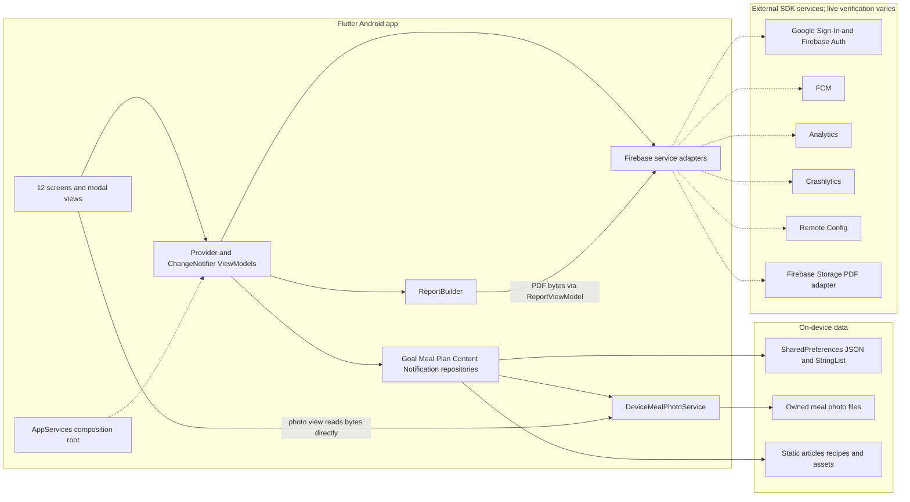
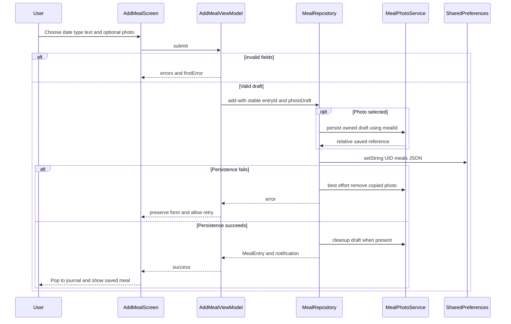
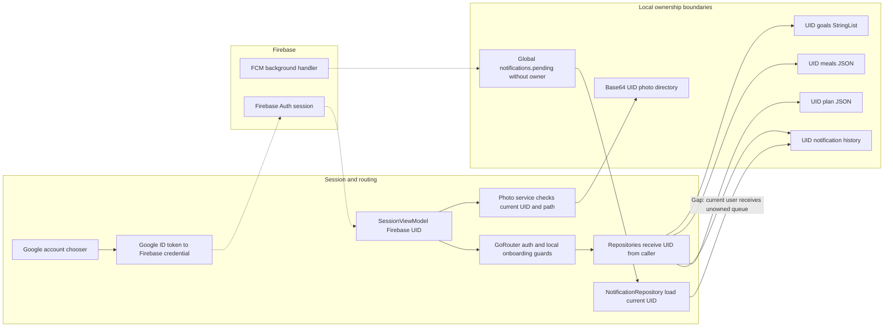
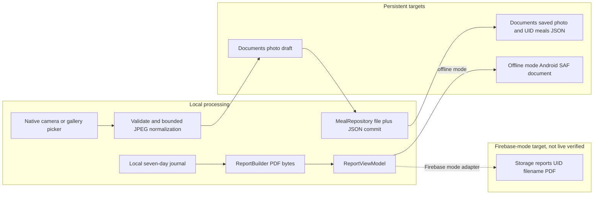

# CURRENT SYSTEM ARCHITECTURE AUDIT — LONGEVITY PLATE

> **Snapshot trước khi pull main:** nội dung dưới đây mô tả working tree dựa trên commit `3abfa0e`, trước khi cập nhật lên `12c60ae` ngày 11/11/2026. Main mới đã thay upload PDF sang Cloudinary/Cloudflare Worker; các lỗi compile ghi trong snapshot này đã được xử lý khi hòa nhập. Đây là tài liệu lịch sử, cần audit lại nếu dùng để mô tả hệ thống sau pull.

**Ngày kiểm tra:** 11/11/2026, Asia/Bangkok. **Root:** `D:\PRM393\Lab3\longevity-plate-lab3`.

**Phạm vi:** phân tích working tree thực tế, đọc source/config/test/tài liệu/bằng chứng; chạy analyzer và test bằng `--no-pub`. Chỉ tạo báo cáo này. Không sửa source, không cài dependency, không build/cài APK, không thay Console, migrate, deploy, commit, push hay dọn cache trong đợt audit.

## A. Project overview

### A1. Executive findings

1. Ứng dụng dùng Flutter/Dart, MVVM thực dụng với Provider/ChangeNotifier, GoRouter, repository local và các interface/adapters Firebase. Không phải hệ thống microservice hoặc Clean Architecture đầy đủ.
2. **Kho dữ liệu nghiệp vụ hiện tại là SharedPreferences trên thiết bị:** bữa ăn, mục tiêu, kế hoạch và lịch sử thông báo. Bữa/kế hoạch/thông báo là JSON; mục tiêu là StringList. Không có Firestore/Realtime Database trong dependency và repository nghiệp vụ đã rà.
3. Firebase có code Core, Google Authentication, Analytics, FCM, Crashlytics, Remote Config và Cloud Storage cho PDF. Điều này không đồng nghĩa các dữ liệu nghiệp vụ đã được đồng bộ cloud.
4. Working tree đang chứa phần redesign/camera bị ngắt giữa chừng. Camera/gallery, file ảnh local, thumbnail và model `imagePath` đã có code, nhưng **snapshot hiện tại không compile**: 2 lỗi nullable public-field promotion và 1 lint. Không có APK mới chứng minh phần ảnh này hoạt động trên OPPO.
5. Có 8 ảnh DebugView xác nhận 8 event custom Analytics đã được nhận ở lần chụp trước; một số ảnh có nhãn Spark. Chưa có bằng chứng tương đương trong repo cho Storage/FCM/Crashlytics/Remote Config thật. Người dùng báo đã nghiệm thu AUTH-01–06 trên OPPO; đợt audit không tái thực hiện các ca đó.
6. Có APK Firebase ký hợp lệ, nhưng timestamp của APK cũ hơn các thay đổi camera/UI; binary không đại diện working tree hiện tại. Log 53 test PASS trước đây là bằng chứng lịch sử.
7. Web Admin, admin role, backend, FCM sender riêng, Cloudinary, Firestore rules/indexes, integration/emulator tests: **NOT_FOUND_IN_SOURCE**.
8. Ràng buộc không bật billing xung đột với adapter PDF Firebase Storage hiện có theo chính sách Firebase hiện hành. Audit không nâng gói hoặc quyết định giải pháp thay thế.

### A2. Quy ước xác minh

| Nhãn | Ý nghĩa trong báo cáo |
|---|---|
| `VERIFIED` | Đã thấy bằng chứng cụ thể: kết quả command mới, binary được kiểm tra, hoặc ảnh Console đã đọc; luôn ghi phạm vi/thời điểm của bằng chứng |
| `IMPLEMENTED_NOT_VERIFIED` | Có code nhưng chưa chứng minh hoạt động end-to-end trên cloud/thiết bị cho working tree này |
| `DOCUMENTED_ONLY` | Mới có trong tài liệu/kịch bản/kế hoạch, không có implementation tương ứng |
| `NOT_FOUND_IN_SOURCE` | Không tìm thấy implementation trong phạm vi source/config được rà; không kết luận dịch vụ đó không tồn tại ngoài repo |
| `NOT_IMPLEMENTED` | Chức năng đang hỏi chưa có implementation; dùng kèm NOT_FOUND_IN_SOURCE khi thích hợp |
| `BLOCKED` | Trạng thái thực thi kiểm tra, ví dụ bị lỗi compile; không phải một bằng chứng PASS |

`VERIFIED` của ảnh Analytics hoặc APK lịch sử không xác nhận toàn bộ feature, tất cả error paths, source mới, hay cấu hình Console hiện tại.

### A3. Git và ranh giới snapshot

- Branch: `feature/lab3-firebase`.
- HEAD: `3abfa0e` — `docs: cập nhật hướng dẫn cài Android theo lần build thật`.
- `git diff --stat` lúc bắt đầu: 26 tracked paths có thay đổi, khoảng 1.341 dòng thêm/303 dòng xóa; còn nhiều untracked files/directories. Đây không phải checkout sạch.
- `android/app/build.gradle.kts` bị xóa trong working tree; module hiện dùng `android/app/build.gradle` Groovy. Không nhầm file bị xóa với việc mất cấu hình Android.
- Thay đổi đang có gồm Firebase config, offline mode, Gradle, UI, `MealEntry.imagePath`, photo services và test ảnh mới. Audit không ghi đè hoặc hoàn tất những thay đổi đó.
- APK Firebase hiện có: 65.069.334 byte, timestamp 10:22:15 ngày 11/11/2026. `pubspec.yaml` và các file camera/UI được sửa sau 13:56 cùng ngày. Timestamp là dấu hiệu khác snapshot, không thay cho build provenance/commit mapping.
- SHA-256 APK đọc trong đợt audit: `8E67947DB5852B65DD2166904E2C85ADB860368E37097C35ED01EA0AF63D8970`; khớp sidecar `.sha256`. Khác hash được ghi trong `docs/build-evidence/FIREBASE_VALIDATION.md`, nên tài liệu đó phải được đọc như lịch sử, không gán cho binary hiện tại.

### A4. Stack, versions và Android

Versions package dưới đây đọc từ **pubspec.lock**, không phải chỉ lấy dấu `^` trong YAML.

| Thành phần | Version/config quan sát |
|---|---|
| Flutter / Dart | 3.47.2 stable / 3.13.2, đọc metadata SDK được dùng trên máy; pubspec yêu cầu Dart `^3.13.2` |
| App | `longevity_plate`, `1.0.0+1` |
| State / routing | provider 6.1.5+1; go_router 18.1.2 |
| Local persistence | shared_preferences 2.5.6; path_provider 2.1.6 |
| PDF / links | pdf 3.13.1; url_launcher 6.3.3 |
| Firebase Core / Auth / Google Sign-In | 5.1.0 / 7.0.1 / 7.2.0 |
| Firebase Storage / Messaging | 14.0.1 / 17.0.1 |
| Firebase Analytics / Crashlytics / Remote Config | 13.0.1 / 6.0.1 / 7.0.1 |
| Ảnh mới | image_picker 1.2.4; image_picker_android 0.8.13+25; image 4.12.0 |
| Test / lint | flutter_test từ SDK; flutter_lints 6.0.0 |
| Android build | AGP 9.1.0; Gradle wrapper 9.3.1; Kotlin compiler ghim 2.4.0; Java target 17 |
| Google Services / Crashlytics Gradle plugins | 4.5.0 / 3.0.8 |
| Android identity | Project `longevity-plate-beff9`; package/namespace `com.longevityplate.longevity_plate` |
| APK đã kiểm tra | minSdk 24; target/compile SDK 36; arm64-v8a, armeabi-v7a, x86_64; chữ ký v2 hợp lệ |
| Release signing | Source dùng `signingConfigs.debug`, phù hợp bản lab, chưa phải quy trình ký production |
| Hiệu năng build | Heap 1536 MB, 1 worker, Kotlin in-process, incremental Kotlin tắt; cache build theo ổ dự án |

Evidence: [pubspec.yaml](D:/PRM393/Lab3/longevity-plate-lab3/pubspec.yaml:19), `pubspec.lock`; [settings.gradle.kts](D:/PRM393/Lab3/longevity-plate-lab3/android/settings.gradle.kts:20); [app/build.gradle](D:/PRM393/Lab3/longevity-plate-lab3/android/app/build.gradle:23); `android/gradle.properties`; `android/gradle/wrapper/gradle-wrapper.properties`.

Manifest app khai báo INTERNET, POST_NOTIFICATIONS, `singleTop`, `adjustResize`; không khai báo CAMERA/READ_MEDIA_IMAGES/quyền đọc toàn bộ storage. Manifest plugin image_picker được đọc có FileProvider không exported và cấp URI permission; source chưa được build lại để xác nhận merged manifest mới. Android native `MainActivity` còn xử lý lưu/mở PDF bằng Storage Access Framework.

Firebase config client có Android options và OAuth client types 1/3; project/package khớp yêu cầu. Không in API key, client IDs, tokens hoặc user identifiers. `DefaultFirebaseOptions.currentPlatform` chỉ hỗ trợ Android; web ném UnsupportedError. Có web shell để chạy fake UI, không có Firebase Web/Admin config được triển khai.

### A5. Theme và project tree

- Theme gốc: Material 3, font Roboto regular/medium/bold có asset tiếng Việt; AppColors/AppText/AppSpace/AppRadius trong [theme.dart](D:/PRM393/Lab3/longevity-plate-lab3/lib/app/theme.dart:4).
- Login/Add Meal đang chuyển sang scoped `Wellness.theme`, cream/forest/sage, card bo lớn, CustomPainter cho lá/sóng/Google mark; không thay bằng một screenshot toàn màn hình. Evidence: [wellness.dart](D:/PRM393/Lab3/longevity-plate-lab3/lib/views/widgets/wellness.dart:7), `onboarding_screens.dart`, `meal_screens.dart`.
- `assets/images/bowl.png`, `toast.png`, `meal_prep.png` là nội dung bundle. Chưa chạy visual QA cho redesign hiện tại vì build source bị chặn.

```text
lib/
  main.dart
  firebase_options.dart
  app/ app.dart, app_services.dart, router.dart, theme.dart
  core/ dates.dart, load_state.dart, push_routes.dart, text.dart
  data/ content_data.dart
  models/ models.dart
  viewmodels/
    session_view_model.dart, goal_view_model.dart, home_view_model.dart
    meal_log_view_model.dart, add_meal_view_model.dart
    library_view_model.dart (LibraryViewModel + ArticleViewModel)
    planner_view_model.dart, recipe_view_model.dart
    account_view_model.dart, notifications_view_model.dart, report_view_model.dart
    safe_notifier.dart
  views/
    onboarding_screens.dart, home_screen.dart, meal_screens.dart
    library_screens.dart, plan_screens.dart
    account_screen.dart, notifications_screen.dart, report_sheet.dart
    widgets/ common.dart, wellness.dart, meal_photo.dart
  services/
    service_interfaces.dart, repositories.dart, report_builder.dart
    app_failure.dart, fake_services.dart, local_services.dart, resilient_telemetry.dart
    meal_photo_service.dart, device_meal_photo_service.dart, fake_meal_photo_service.dart
    firebase/
      firebase_auth_service.dart, firebase_analytics_service.dart
      firebase_storage_service.dart, firebase_messaging_service.dart
      firebase_crash_service.dart, firebase_remote_config_service.dart
test/
  auth_and_guard_test.dart, firebase_features_test.dart, flows_test.dart
  layout_test.dart, local_mobile_test.dart, meal_photos_test.dart, helpers.dart
integration_test/  NOT_FOUND_IN_SOURCE
android/
  settings.gradle.kts, build.gradle.kts, gradle.properties
  gradle/wrapper/gradle-wrapper.properties
  app/build.gradle, app/google-services.json
  app/src/main/AndroidManifest.xml
  app/src/main/kotlin/com/longevityplate/longevity_plate/MainActivity.kt
scripts/ build-android.ps1
firebase/ storage.rules
firebase.json  (chỉ cấu hình Storage rules)
web/ index.html, manifest.json, icons/  (Flutter bootstrap)
docs/
  architecture.md, analytics-plan.md, design-traceability.md, test-cases.md
  SETUP-FIREBASE.md, ANDROID-APK.md
  LAB3_GAP_ANALYSIS_AND_PLAN_2026-11-11.md
  LAB3_FIREBASE_ACCEPTANCE_GUIDE_VI.md, build-evidence/
evidence/analysis/  (8 ảnh Analytics)
```

Không liệt kê generated files, cache, binary hoặc credential values. Không thấy `.github/workflows`, backend/functions project, Firestore rules/indexes hoặc emulator configuration.

## B. MVVM đang triển khai

### B1. Views và navigation

Có 12 screen classes chính: Welcome, Login, Goals, Home, MealLog, AddMeal, Library, Article, Planner, Recipe, Account, Notifications; thêm Report bottom sheet và photo dialog. Planner có cả entry từ tab và `/article-plan`.

Views dựng `ChangeNotifierProvider` cho VM tương ứng, sử dụng `context.watch/read/select`. Session/Notifications dùng provider ở root. GoRouter quản lý route/guards, `StatefulShellRoute.indexedStack` giữ bốn tab. Evidence: [app.dart](D:/PRM393/Lab3/longevity-plate-lab3/lib/app/app.dart:95), [router.dart](D:/PRM393/Lab3/longevity-plate-lab3/lib/app/router.dart:42).

Ranh giới chưa thuần MVVM:

- `MealPhotoView._load()` gọi `context.read<AppServices>().photos.read(...)` trực tiếp từ View để đọc bytes, bypass VM: [meal_photo.dart:84](D:/PRM393/Lab3/longevity-plate-lab3/lib/views/widgets/meal_photo.dart:84).
- Root app gọi Analytics screen tracking và Crashlytics custom key trực tiếp: [app.dart:45](D:/PRM393/Lab3/longevity-plate-lab3/lib/app/app.dart:45). Đây là logic cross-cutting.
- Views xử lý date picker, modal xác nhận discard/replace/crash, Clipboard, UI navigation và truyền UID lấy từ Session vào VM. Không thấy Views import Firebase SDK trực tiếp.
- AccountViewModel biết `FakeRemoteConfigService` cho điều khiển offline, nên vẫn có coupling với implementation giả lập.

### B2. Danh sách đầy đủ ViewModel

| ViewModel | File/class line | State chính | Dependencies / trách nhiệm |
|---|---|---|---|
| SessionViewModel | `lib/viewmodels/session_view_model.dart:9` | AppUser?, signingIn, message, isOnboarded | AppServices.Auth, goals, analytics, crash; sign-in/out, identity, guard refresh |
| GoalViewModel | `lib/viewmodels/goal_view_model.dart:9` | selected goals, requiredError, saving/saveFailed | goals repository, Session, telemetry; validate/lưu onboarding |
| HomeViewModel | `lib/viewmodels/home_view_model.dart:11` | LoadState, meals, plan | meals/plans/content; tổng hợp hôm nay, gợi ý |
| MealLogViewModel | `lib/viewmodels/meal_log_view_model.dart:11` | date, LoadState, meals, showSaved, loadId | meals repository, telemetry; đổi ngày/load/retry |
| AddMealViewModel | `lib/viewmodels/add_meal_view_model.dart:17` | date/type/description, field errors, dirty, saving, pickingPhoto, reference/message, completed | meals/photos/telemetry; validate, picker/recovery, save/retry/discard |
| LibraryViewModel | `lib/viewmodels/library_view_model.dart:12` | load state, articles, query, timer | content, RC, telemetry, link opener; tìm kiếm không dấu và debounce 800ms |
| ArticleViewModel | `lib/viewmodels/library_view_model.dart:104` | LoadState, Article? | content, telemetry, link opener; đọc bài, mở nguồn, mốc bắt đầu plan |
| PlannerViewModel | `lib/viewmodels/planner_view_model.dart:18` | selectedDate, LoadState, slots, banner, loadId | plans/content/RC; tuần 7 ngày, slots, refresh sau lưu |
| RecipeViewModel | `lib/viewmodels/recipe_view_model.dart:11` | recipe, LoadState, date/slot, saving/saveFailed | content/plans/telemetry; chọn ngày/bữa, thay món, lưu kế hoạch |
| AccountViewModel | `lib/viewmodels/account_view_model.dart:9` | token, probeResult, probing, refreshingConfig, nonFatalMessage | goals, FCM, RC, Storage, Crash, faults; khu vực trình diễn |
| NotificationsViewModel | `lib/viewmodels/notifications_view_model.dart:15` | items, permission, UID, pendingOpen, errorMessage | Session, messaging, notifications repo, analytics; nhận/mở/lịch sử tin |
| ReportViewModel | `lib/viewmodels/report_view_model.dart:11` | ReportPhase, progress, URL, error/notice, mealCount | meals, ReportBuilder, storage, analytics, crash, link opener |

Tất cả kế thừa ChangeNotifier; phần lớn dùng SafeNotifier để không notify sau dispose. Không thấy Firebase SDK imports trực tiếp trong VM. `AppServices` là service locator/composition root chứa **concrete repository classes**, chưa có domain repository interfaces hoặc use-case layer.

Loading/error/retry đã có cho các luồng chính. MealLog/Planner có loadId để loại response cũ; không phải mọi VM có cùng cơ chế. Một số async callback còn thiếu catch/session recheck; xem G.

### B3. Models thực tế

| Model | Fields / serialization / ownership |
|---|---|
| AppUser | `uid:String`, `displayName:String?`, `email:String?`; map từ Firebase User, không có JSON/profile repository riêng; `service_interfaces.dart:9` |
| Goal | Enum logMeals/planMeals/learn, label:String; serialize enum.name bằng StringList dưới UID; `models.dart:1` |
| MealType | Enum breakfast/lunch/dinner/snack; `models.dart:10` |
| MealEntry | id:String, date:String yyyy-MM-dd, type:MealType, description:String, createdAt:DateTime, imagePath:String?; fromJson/toJson ISO timestamp; field ảnh vắng ở record cũ được chấp nhận; `models.dart:20` |
| Weekly Plan | Không có class WeeklyPlan. JSON `Map<dateKey, Map<slotName, recipeId>>` trong PlanRepository; owner nằm ở key SharedPreferences |
| PlanSlot | Enum breakfast/lunch/dinner với shortLabel, label, time:String và hour:int; `models.dart:58` |
| PlanSaveResult | date:DateTime, slot:PlanSlot, replaced:bool; DTO điều hướng trong `planner_view_model.dart:10`, không serialize |
| Recipe | id/title/summary/image:String, ingredients/steps:List<String>; const local data, không JSON/UID; `models.dart:70` |
| ArticleSection | title/body:String; `models.dart:88` |
| Article | id/title/source/image:String; sourceDate/note/summary/sourceUrl/sourceLinkLabel:String?; sections:List<ArticleSection>; externalOnly:bool; const local, không owner; `models.dart:95` |
| PushMessage | id/title/body:String, route:String?; DTO ánh xạ RemoteMessage, không có recipient UID; `service_interfaces.dart:47` |
| AppNotification | id/title/body:String, route:String?, receivedAt:DateTime, read:bool; JSON/ISO timestamp, markedRead tạo bản mới; owner chỉ ở storage key; `models.dart:125` |
| UploadProgress | fraction:double, downloadUrl:String?; DTO stream, không persistent report record; `service_interfaces.dart:26` |
| Report | Không có class/report metadata repository. PDF bytes và URL nằm tạm trong ReportViewModel; ReportPhase enum điều khiển UI |
| Photo | Không có Photo entity. MealPhotoSource enum, String reference trong MealEntry và ViewModel; bytes qua MealPhotoService |
| Khác | LoadState enum; MealField enum; AppFailure(code, message); FaultPoint/FaultInjector; RecordedEvent chỉ dùng fake analytics |

MealEntry không có owner UID trong JSON; ownership dựa vào container `<uid>.meals`. RecipeId trong plan tham chiếu catalog tĩnh, chưa có quan hệ database hoặc foreign-key constraint. Meal id mới của VM là timestamp microseconds + Random.secure; repository fallback timestamp nếu caller không truyền id. ID của article/recipe được hardcode trong data file.

### B4. Interfaces, implementations và dependency injection

| Interface | Real / local / fake | Data source |
|---|---|---|
| AuthService | FirebaseAuthService / LocalAuthService / FakeAuthService | Firebase Auth SDK / prefs session bool / memory stream |
| ReportStorageService | FirebaseReportStorageService / DeviceReportStorageService / FakeReportStorageService | Firebase Storage / Android SAF / fake URL và progress |
| MessagingService | FirebaseMessagingService / FakeMessagingService | FCM native SDK / StreamController giả lập |
| AnalyticsService | FirebaseAnalyticsService bọc ResilientAnalyticsService / FakeAnalyticsService | Google Analytics / memory event list |
| CrashService | FirebaseCrashService / FakeCrashService | Crashlytics / memory error list |
| RemoteConfigService | FirebaseRemoteConfigService / FakeRemoteConfigService | SDK cache/realtime / memory defaults |
| MealPhotoService | DeviceMealPhotoService / FakeMealPhotoService | app documents files / memory bytes |
| MealPhotoPicker | NativeMealPhotoPicker / `_Picker` trong test | image_picker camera/gallery/lost result / fixture files |

Các domain repositories Goal/Meal/Plan/Content/Notification hiện là concrete classes. ReportBuilder cũng concrete; link opener là callback `Future<bool> Function(Uri)` có thể inject. AppServices nhận phụ thuộc constructor; factory firebase/local/fake quyết định implementation. Evidence: [AppServices](D:/PRM393/Lab3/longevity-plate-lab3/lib/app/app_services.dart:22), [service interfaces](D:/PRM393/Lab3/longevity-plate-lab3/lib/services/service_interfaces.dart:17), [photo interface](D:/PRM393/Lab3/longevity-plate-lab3/lib/services/meal_photo_service.dart:6).

## C. Database và data persistence — kết luận chính

**DATABASE NGHIỆP VỤ HIỆN TẠI: SharedPreferences local chứa JSON/StringList, kèm filesystem cho ảnh. Không có cloud database nghiệp vụ.** Firebase Auth lưu identity/session bằng SDK; Analytics/FCM/Crashlytics/RC là các dịch vụ khác, không thay cho database meals/plans.

| Dữ liệu | Model / repository | Storage thực tế | Theo UID? | Đồng bộ cloud? | Offline |
|---|---|---|---|---|---|
| User profile/session | AppUser / AuthService / SessionVM | Firebase User/currentUser qua SDK; local mode có `local.signed_in` | UID từ Auth; local mode ID riêng | Auth identity có ở Firebase; không có profile DB app riêng | Có phiên đã lưu; login Google mới vẫn cần điều kiện mạng/provider |
| Meals | MealEntry / MealRepository | JSON string `<uid>.meals` | Có namespace; repo nhận UID từ caller | **Không** | Có, nếu có UID/session cần thiết |
| Goals | Goal / GoalRepository | StringList `<uid>.goals` | Có namespace | Không | Có |
| Weekly Plans | date/slot→recipeId / PlanRepository | JSON string `<uid>.plan` | Có namespace | Không | Có |
| Articles | Article / ContentRepository | const `articlesData`, bundled images | Shared catalog, không owner | Không fetch CMS/cloud | Có |
| Recipes | Recipe / ContentRepository | const `recipesData`, bundled images | Shared catalog | Không | Có |
| Meal photos | String imagePath / DeviceMealPhotoService | documents/meal_photos/base64url(uid)/draft hoặc saved | Có guard currentUid và relative-path validation | **Không upload/cloud sync** | Có code local; runtime chưa verified |
| Reports | PDF bytes / ReportBuilder + ReportVM | RAM → Firebase object hoặc SAF document; URL ở VM | Cloud path có UID + rules source | Chỉ upload object PDF nếu service/bucket hoạt động; không sync meals hoặc report metadata | Offline mode lưu SAF; Firebase upload cần mạng |
| Notifications | AppNotification / NotificationRepository | JSON `<uid>.notifications`, max history 100 | Lịch sử có; **pending queue toàn thiết bị** | Tin đi qua FCM; lịch sử app không sync cloud | Đọc lịch sử local |
| Pending notifications | JSON list / static enqueue | `notifications.pending` | **Không có recipient UID** | Không | Local queue |
| Pending photo picker | owner key / DeviceMealPhotoService | `meal_photo.pending_owner`, một owner slot | Base64 UID, đối chiếu session | Không | Local recovery marker |

Evidence chính: [GoalRepository:28](D:/PRM393/Lab3/longevity-plate-lab3/lib/services/repositories.dart:28), [MealRepository:52](D:/PRM393/Lab3/longevity-plate-lab3/lib/services/repositories.dart:52), [PlanRepository:163](D:/PRM393/Lab3/longevity-plate-lab3/lib/services/repositories.dart:163), [NotificationRepository:252](D:/PRM393/Lab3/longevity-plate-lab3/lib/services/repositories.dart:252), [static content](D:/PRM393/Lab3/longevity-plate-lab3/lib/data/content_data.dart:9).

### C1. Save/restart/account switching

- Add meal → AddMealVM validate → MealRepository.add → decode toàn bộ JSON của UID → append → encode và setString. Khi có ảnh, copy draft sang saved trước, ghi relative reference rồi dọn draft.
- Restart → SharedPreferences.getInstance trong main; Auth SDK khôi phục currentUser → VM dùng UID → đọc lại các keys local. Không có request Firestore để tải meals/plans.
- Cùng tài khoản trên máy khác: Auth có thể đăng nhập được nhưng meal/goal/plan/history/photo local **không tự xuất hiện**. Android OS backup/restore, nếu có, là cơ chế riêng và chưa xác minh; không được gọi là app cloud sync.
- Logout không xóa JSON/photos của A. B dùng các keys của B. Đăng nhập lại A trên cùng bản cài vẫn có dữ liệu A nếu chưa gỡ/xóa data. Pending notification là ngoại lệ cần xử lý ở G.
- Uninstall/clear app data có thể mất dữ liệu trong sandbox; PDF xuất SAF nằm ngoài sandbox theo document provider được chọn.

### C2. Transactions, migrations và CRUD

| Khả năng | Hiện trạng |
|---|---|
| Data schema version/migration framework | NOT_FOUND_IN_SOURCE; chỉ có backward compatibility cho `imagePath` vắng |
| Transaction/atomic multi-record commit | NOT_FOUND_IN_SOURCE; đọc–sửa–ghi toàn bộ JSON, không DB transaction/global write lock |
| Chống double tap | VM `saving/busy/_completed`; AddMealVM giữ entryId, repo tìm id đã có trước append |
| Idempotency phạm vi | Một draft/retry và record ID local; không phải distributed exactly-once; concurrent writers vẫn có nguy cơ lost update |
| Meal delete | Có `MealRepository.delete`, hard delete record rồi cleanup photo; chưa có delete UI tương ứng |
| Meal edit/update | NOT_FOUND_IN_SOURCE trong UI/repository hiện tại |
| Plan update | `setSlot` cập nhật/thay một slot trong map; last local write overwrites |
| Soft delete/tombstone | NOT_FOUND_IN_SOURCE |
| Conflict resolution/multi-device sync | NOT_FOUND_IN_SOURCE |
| Pending cloud writes/outbox | NOT_FOUND_IN_SOURCE; notification pending không phải outbox nghiệp vụ |
| Query/pagination | Filter/sort local sau decode cả list; không query database/index/listener cloud |

### C3. Firestore-specific audit

`cloud_firestore`, FirebaseFirestore client calls, collections/document paths, Firestore CRUD/listeners/pagination, `firestore.rules`, `firestore.indexes.json`, Firestore emulator tests và Firestore sync repositories: **NOT_FOUND_IN_SOURCE**. Realtime Database SDK/calls cũng không tìm thấy. Không có SQLite/Hive/Isar backend trong source nghiệp vụ. Audit không kiểm tra Console để suy ra có/không một database do ai đó tạo ngoài repo.

## D. Firebase integration audit

### D1. Service matrix

| Service | SDK / implementation | Nơi sử dụng thực tế trong code | Xác minh |
|---|---|---|---|
| Firebase Core | firebase_core; `main()` initializeApp; Android FirebaseOptions | Bootstrap chế độ Firebase | IMPLEMENTED_NOT_VERIFIED cho working tree; kết nối của build trước có bằng chứng Analytics |
| Authentication | firebase_auth + google_sign_in; FirebaseAuthService | Login → credential → Session → guards/UID | IMPLEMENTED_NOT_VERIFIED trong đợt audit; người dùng đã báo AUTH-01–06 PASS trên OPPO; ảnh `login` xác nhận Analytics login marker, không thay bộ bằng chứng Auth |
| Cloud Firestore | Không có SDK/calls/repository | Không có | NOT_FOUND_IN_SOURCE |
| Cloud Storage | firebase_storage; FirebaseReportStorageService | Upload PDF, progress, URL, foreign-UID probe | IMPLEMENTED_NOT_VERIFIED; không có ảnh Files/rules result/upload receipt; còn ràng buộc billing |
| Messaging | firebase_messaging; FirebaseMessagingService | Permission/token; foreground/opened/initial/background; lịch sử và route | IMPLEMENTED_NOT_VERIFIED; test hiện dùng fake; chưa có bằng chứng FCM thật ba trạng thái |
| Analytics | firebase_analytics + resilient wrapper | 17 custom events + screen_view, UID | **VERIFIED ở 8 event snapshot**; những event/error paths khác IMPLEMENTED_NOT_VERIFIED; không tái chạy cloud ở audit |
| Crashlytics | firebase_crashlytics + Gradle plugin | Flutter/platform fatal handlers, recordError, UID/route, demo fatal/non-fatal | IMPLEMENTED_NOT_VERIFIED; không có issue/event Console thực tế trong evidence được rà |
| Remote Config | firebase_remote_config | defaults/cache/fetchAndActivate/realtime → Library/Planner | IMPLEMENTED_NOT_VERIFIED; không có Console template/version hoặc ảnh before/after UI trong evidence |

Đường dẫn SDK/adapters: [main.dart:32](D:/PRM393/Lab3/longevity-plate-lab3/lib/main.dart:32), [AppServices.firebase:53](D:/PRM393/Lab3/longevity-plate-lab3/lib/app/app_services.dart:53), thư mục `lib/services/firebase/`. Có client config không chứng minh provider/API/rules/bucket đã bật hoặc deploy.

### D2. Authentication

- `FirebaseAuthService._ensureGoogleInit()` initialize Google một lần; `authenticate()` lấy account/idToken, `GoogleAuthProvider.credential(idToken:...)`, `FirebaseAuth.signInWithCredential(...)`. ID token là biến runtime, không thấy code log hoặc lưu token vào SharedPreferences của app. Evidence: [firebase_auth_service.dart:16](D:/PRM393/Lab3/longevity-plate-lab3/lib/services/firebase/firebase_auth_service.dart:16).
- `authStateChanges()` và `currentUser` map sang AppUser. SessionVM subscribe stream; main chờ event đầu tối đa 3 giây để tránh nháy sai màn. App không tự viết token/session persistence thay Firebase SDK.
- Cancel/interrupted được map SignInCancelled; SessionVM giữ ở login và có thông báo. Network/config failure có thông báo retry và recordError. `signingIn` chống gửi trùng.
- Logout gọi Google signOut rồi Firebase signOut. Nếu bước đầu ném lỗi, bước sau chưa chạy và UI báo lỗi; không có transaction hai provider. Thành công → session stream đổi → router redirect.
- Session `_applyIdentity()` đặt Analytics UID và Crashlytics UID; logout đặt Analytics null, Crashlytics chuỗi rỗng. Không xóa records local/photos: [session_view_model.dart:45](D:/PRM393/Lab3/longevity-plate-lab3/lib/viewmodels/session_view_model.dart:45).
- Guards: anonymous chỉ vào welcome/login; signed-in chưa có goals buộc goals; đã onboard chuyển login/welcome về home; edit goals vẫn được. `isOnboarded` đọc key goals **trên thiết bị hiện tại**, không phải cờ cloud: [router.dart:16](D:/PRM393/Lab3/longevity-plate-lab3/lib/app/router.dart:16).
- A/B namespace tồn tại trong source nhưng chưa có automatic migration/merge giữa local-user và Firebase UID. Không thấy admin claims/role checks.

### D3. Analytics — toàn bộ event có call site

Các hằng ở [service_interfaces.dart:103](D:/PRM393/Lab3/longevity-plate-lab3/lib/services/service_interfaces.dart:103) đều có nơi phát sinh, không chỉ nằm trong plan.

| Event | Call site | Parameters app gửi | Bằng chứng Console đã thấy |
|---|---|---|---|
| login | SessionVM.signIn, line 57 | method: google/local | `evidence/analysis/login.png`, method=google |
| logout | SessionVM.signOut, line 86 | không có custom parameter | Có trong Top events của một số ảnh; chưa có ảnh detail riêng |
| tutorial_begin | GoalVM constructor, line 12 | none | Chưa có |
| tutorial_complete | GoalVM.submit, line 48 | goal_count:int, duration_ms:int | Chưa có |
| meal_add_start | MealLogVM.logAddStart, line 47 | none | `meal_add_start.png` |
| meal_saved | AddMealVM.submit, line 211 | meal_type:String, duration_ms:int | `meal_save.png`; tên event hiển thị thực tế là meal_saved |
| meal_save_failed | AddMealVM.submit catch, line 221 | meal_type:String | `meal_save_failed.png` |
| meal_draft_discarded | AddMealVM.logDiscard, line 72 | none | Chưa có |
| select_content | LibraryVM.openExternal line 80 / ArticleVM.load line 121 | content_type:String, item_id:String | `select_content.png`, content_type=article |
| article_search | LibraryVM.setQuery, line 57 | result_count:int; debounce 800ms | Chưa có |
| plan_from_article | ArticleVM.startPlan, line 136 | item_id:String | `plan_from_artical.png`; tên file viết khác tên event |
| recipe_view | RecipeVM.load, line 59 | item_id:String | `recipe_view.png` |
| plan_slot_saved | RecipeVM.save, line 92 | meal, action:add/replace, source:article/planner, duration_ms | `plan_slot_save.png`; event thực là plan_slot_saved |
| plan_save_failed | RecipeVM.save catch, line 103 | meal:String | Chưa có |
| report_exported | ReportVM.export, line 62 | meal_count:int, size_kb:int | Chưa có |
| report_export_failed | ReportVM.export catch, line 69 | code:String | Chưa có |
| notification_opened | NotificationsVM.open, line 165 | source:system/foreground/history, target:String | Chưa có |
| screen_view | app `_onRouteChanged` → logScreenView | screenName=route | Có trong Top events và firebase_screen ở ảnh |

Phạm vi VERIFIED: đã đọc trực quan cả 8 ảnh, thấy event names/parameters trên DebugView; một số ảnh có URL đúng project/package. Không tái phát event, không mở Console live. Không suy ra từng event thuộc working tree camera mới. Không sao chép session IDs hoặc dữ liệu cá nhân từ ảnh.

Không thấy gửi email/displayName/description/search query/photo bytes/photo path vào các parameter app đang khai báo. UID được setUserId riêng. `ResilientAnalyticsService` catch lỗi Analytics ở chế độ Firebase; AddMealVM mới còn bảo vệ telemetry sau commit để không đổi save thành failure. Các crash reporting call chưa có wrapper tương đương.

### D4. FCM

- `onForeground` map `FirebaseMessaging.onMessage`; root app hiện SnackBar có Xem. Không có code tạo Android foreground local notification channel/tray riêng.
- `onOpened` map onMessageOpenedApp; `initialMessage` gọi getInitialMessage; chưa đăng nhập thì giữ `_pendingOpen` trong RAM đến sau login.
- Background handler có `@pragma('vm:entry-point')`, initialize Firebase và enqueue notification local. Không thể gọi Provider UI trong isolate nền.
- Permission gồm granted/denied/notDetermined; onboarding hỏi khi chưa xác định; Notifications screen có Bật thông báo. Không thấy launcher mở thẳng Android Settings khi permission bị từ chối vĩnh viễn.
- Token hiện lấy bằng legacy `getToken()` để copy trong Account. Không có token registration repository/server, `onTokenRefresh` hoặc sender Admin SDK/HTTP v1 trong source. Không tự đổi sang FID trong audit.
- `resolvePushRoute` chỉ cho phép tab routes, notifications và article/recipe IDs hợp lệ trong catalog; route lạ/null về notifications. Evidence: [push_routes.dart:7](D:/PRM393/Lab3/longevity-plate-lab3/lib/core/push_routes.dart:7).
- History theo UID có dedupe message ID và tối đa 100 entries; pending background queue dùng **một key chung**, không owner, được lần load sau nhập vào UID hiện tại. Đây là gap A/B quan trọng, không được gọi toàn bộ messaging là đã isolate.

Evidence: [firebase_messaging_service.dart:26](D:/PRM393/Lab3/longevity-plate-lab3/lib/services/firebase/firebase_messaging_service.dart:26), [NotificationsVM:134](D:/PRM393/Lab3/longevity-plate-lab3/lib/viewmodels/notifications_view_model.dart:134), [NotificationRepository:252](D:/PRM393/Lab3/longevity-plate-lab3/lib/services/repositories.dart:252).

### D5. Remote Config

| Key | Default | UI consumer |
|---|---|---|
| max_knowledge_results | int 3 | LibraryVM.results.take(limit); nonpositive remote value fallback 3 |
| suggested_recipes_enabled | bool true | PlannerVM.showSuggestions → S06 Món gợi ý |

`init()` setDefaults, fetchTimeout 10 giây, minimumFetchInterval debug=0/release=1 giờ, không chờ refresh mạng (`unawaited`); subscribe onConfigUpdated → activate → notifyListeners. `refresh()` fetchAndActivate, lỗi thì giữ cache/default và cập nhật status. Evidence: [firebase_remote_config_service.dart:25](D:/PRM393/Lab3/longevity-plate-lab3/lib/services/firebase/firebase_remote_config_service.dart:25), [keys/defaults:84](D:/PRM393/Lab3/longevity-plate-lab3/lib/services/service_interfaces.dart:84), `LibraryVM._limit`, `PlannerVM.showSuggestions`, `plan_screens.dart`.

Có cache/default/realtime implementation; chưa có evidence publish/activate/UI thật. Callback realtime async chưa bọc riêng `activate()` error. Không có secret trong các default values tìm thấy.

### D6. Crashlytics

`FlutterError.onError` → recordFlutterFatalError; `PlatformDispatcher.onError` → recordError fatal=true; recordError interface mặc định non-fatal, có StackTrace/reason. `setUserIdentifier(uid)` và custom key `route` được gọi từ Session/root router. Account có Ghi lỗi non-fatal (`demo_non_fatal`) và nút crash xác nhận gọi `_crashlytics.crash()`. Evidence: [firebase_crash_service.dart:7](D:/PRM393/Lab3/longevity-plate-lab3/lib/services/firebase/firebase_crash_service.dart:7), [app.dart:51](D:/PRM393/Lab3/longevity-plate-lab3/lib/app/app.dart:51), [account_view_model.dart:77](D:/PRM393/Lab3/longevity-plate-lab3/lib/viewmodels/account_view_model.dart:77).

Không thấy custom keys khác như role/screen; không có custom admin crash database/export pipeline. Tests fake crash chỉ chứng minh luồng xác nhận/call, không chứng minh upload Crashlytics thật. Chưa có ảnh fatal/non-fatal issue trong evidence được rà.

## E. Camera, ảnh bữa ăn và PDF

### E1. Camera/gallery có code nhưng chưa nghiệm thu

| Câu hỏi | Hiện trạng |
|---|---|
| Nút camera/gallery | Có trong `meal_screens.dart:628/649`, gọi AddMealVM.pickPhoto |
| Package camera | image_picker có; package `camera` riêng không cần/không thấy |
| Native camera/gallery | NativeMealPhotoPicker.pick gọi ImageSource.camera/gallery, maxWidth/Height 1600, quality 82, requestFullMetadata=false |
| Valid/resize/compress | DeviceMealPhotoService.normalizePhoto: cap input 20 MiB; cap kích thước descriptor/40 triệu pixel; target dài tối đa 1600; JPEG quality 82 trên compute isolate; cap file output 5 MiB |
| Orientation | Native picker + Flutter image codec là đường xử lý; có test EXIF mới nhưng chưa chạy được, **không xác nhận orientation đã đạt trên thiết bị** |
| Draft/save | Draft trong documents, copy sang saved khi repository add; JSON lưu reference tương đối |
| Liên kết mealId | Saved filename chứa mealId; MealEntry.imagePath liên kết tới file |
| Record cũ | fromJson cho imagePath=null khi field vắng |
| Thumbnail/fullscreen | Có MealPhotoView, dialog InteractiveViewer, missing/corrupt fallback; chưa widget/device verified |
| Cancel/replace/remove | Code giữ draft khi picker trả null; chỉ thay sau khi ảnh mới chuẩn bị xong; remove/discard dọn draft |
| Android lost result | recover chỉ cho pending owner; gọi khi AddMealVM được tạo, không phải recovery route tự động lúc startup |
| Giữ form sau process death | Không persist toàn bộ date/type/description; recover ảnh không đồng nghĩa recover toàn form |
| Xóa bữa | Repository hard delete + cleanup ảnh; chưa có UI delete |
| Logout | Không xóa saved photos; currentUid guard chặn read/delete sai phiên |
| Cloud image upload | **NOT_IMPLEMENTED / NOT_FOUND_IN_SOURCE** |
| Cloudinary | SDK/REST/preset/signed upload/backend/public-private policy: **NOT_FOUND_IN_SOURCE** |

Evidence: [NativeMealPhotoPicker:20](D:/PRM393/Lab3/longevity-plate-lab3/lib/services/device_meal_photo_service.dart:20), [owner/path guard:68](D:/PRM393/Lab3/longevity-plate-lab3/lib/services/device_meal_photo_service.dart:68), [prepare:132](D:/PRM393/Lab3/longevity-plate-lab3/lib/services/device_meal_photo_service.dart:132), [persist:213](D:/PRM393/Lab3/longevity-plate-lab3/lib/services/device_meal_photo_service.dart:213), [MealRepository.add:84](D:/PRM393/Lab3/longevity-plate-lab3/lib/services/repositories.dart:84).

Ảnh dưới app documents, ví dụ cấu trúc:

```text
meal_photos/<base64url(uid)>/draft/<nonce>.jpg
meal_photos/<base64url(uid)>/saved/<mealId>_<nonce>.jpg
```

Base64 UID là encoding, không phải encryption. `_file()` kiểm tra prefix đúng owner và whitelist phần còn lại, chống absolute/path traversal; currentUid được đọc từ AuthService. Không gửi ảnh ra ngoài. Có prune draft .jpg cũ hơn một ngày khi chuẩn bị ảnh mới; chưa có garbage-collector/transaction bao quát mọi partial write/saved orphan.

Tất cả nhận xét trên là **ý nghĩa implementation**. Do 2 lỗi compile, không được ghi camera/gallery/durable photo đã hoạt động thực tế. APK hiện có được tạo trước source này.

### E2. Luồng PDF thực tế

`Nhật ký → showReportSheet → ReportViewModel.export → meals.inRange(uid, today-6, today) → ReportBuilder.build → PDF Uint8List`.

- ReportBuilder chạy local bằng package pdf, nhúng font Roboto; bảng ngày/bữa/giờ/mô tả, A4, không có ảnh bữa ăn trong PDF.
- Firebase mode: `FirebaseReportStorageService.upload` → `putData(application/pdf)` tại `reports/<uid>/<fileName>` → snapshot progress → getDownloadURL. **Có code upload thật**, không phải chỉ fake URL; nhưng chưa có end-to-end cloud evidence cho adapter này.
- Offline mode: MethodChannel `com.longevityplate/documents` → MainActivity ACTION_CREATE_DOCUMENT → ghi PDF qua ContentResolver → trả content URI; openPdf chỉ nhận content scheme. Không cần quyền đọc toàn bộ storage.
- Fake mode: progress/URL giả; URL `example.invalid` không phải bằng chứng cloud upload.
- SDK maxUploadRetryTime 30 giây, maxOperationRetryTime 15 giây; UI có Thử lại. Không có durable upload queue/resume sau process death.
- Storage rules trong source chỉ cho owner read/create PDF nhỏ hơn 5 MiB. Không có client-side PDF size validation riêng hoặc report metadata collection; không thấy update/delete grant. Việc rules đã được deploy chưa xác minh.

Evidence: [ReportVM.export:30](D:/PRM393/Lab3/longevity-plate-lab3/lib/viewmodels/report_view_model.dart:30), [ReportBuilder.build:9](D:/PRM393/Lab3/longevity-plate-lab3/lib/services/report_builder.dart:9), [Firebase upload:20](D:/PRM393/Lab3/longevity-plate-lab3/lib/services/firebase/firebase_storage_service.dart:20), [DeviceReportStorageService:46](D:/PRM393/Lab3/longevity-plate-lab3/lib/services/local_services.dart:46), [MainActivity:14](D:/PRM393/Lab3/longevity-plate-lab3/android/app/src/main/kotlin/com/longevityplate/longevity_plate/MainActivity.kt:14), [storage.rules:6](D:/PRM393/Lab3/longevity-plate-lab3/firebase/storage.rules:6).

## F. Business flows — positive và negative paths

Các flow mô tả đường code tồn tại; working tree đang bị compile blocker, nên không phải kết quả chạy lại UI.

### F01 — Onboarding

```text
main → SharedPreferences + chọn Firebase/local/fake services
  → SessionViewModel + GoRouter.guardRedirect
  → WelcomeScreen /welcome → Bắt đầu
  → guard chưa đăng nhập → LoginScreen /login
  → SessionVM.signIn → AuthService → Google token + Firebase credential (Firebase mode)
  → authStateChanges/AppUser.uid → guard → GoalsScreen /goals
  → GoalVM.toggle/submit → GoalRepository.save
  → SharedPreferences StringList <uid>.goals
  → Session.refreshOnboarding → router refresh → HomeScreen /home
  → NotificationsVM.requestAfterOnboarding
```

Negative: cancel login giữ Login; lỗi mạng/config có message/retry; chưa chọn goal báo required, không lưu; fault saveGoals giữ selection và retry; logout đổi identity/guard nhưng giữ local records. Đăng nhập trên thiết bị mới có thể phải onboarding lại vì goals chưa sync.

### F02 — Meal logging

```text
MealLogScreen /log → MealLogVM.load(date)
  → MealRepository.forDate(uid, date) → SharedPreferences JSON → LoadState + list
  → Thêm bữa → meal_add_start → AddMealScreen /log/add
  → AddMealVM: date/type/description + optional photo picker
  → validate ngày không tương lai, type bắt buộc, description trim 1..120
  → submit với stable entryId, busy/completed guard
  → MealRepository.add → optional photo.persist → JSON setString <uid>.meals
  → cleanup draft, notifyListeners, meal_saved
  → pop(true) → MealLogVM.markSaved / repository listener load lại
  → banner và card; imagePath có thì thumbnail/dialog local
```

Negative: required fields giữ form và focus/scroll tới lỗi; Back với dirty draft hỏi xác nhận; picker cancel giữ text/ảnh cũ; ảnh lỗi/mất có message/fallback; lưu lỗi giữ draft để retry; fault injection tạo nhánh meal_save_failed. Không có request ghi meal tới Firebase database. File+prefs là nhiều bước, chưa có transactional crash recovery.

### F03 — Knowledge → weekly meal plan

```text
LibraryScreen /library → LibraryVM.load → ContentRepository.articles
  → const articlesData → query normalize + Remote Config result limit → UI
  → ArticleScreen /library/:id → ArticleVM.load → const article → select_content
  → Lập kế hoạch → ArticleVM.startPlan → plan_from_article + timestamp
  → PlannerScreen /article-plan → PlannerVM → PlanRepository.forDate(uid, date)
  → chọn slot/món → RecipeScreen /plan/recipe/:id
  → RecipeVM.load → ContentRepository.recipe → const recipe + recipe_view
  → choose date/slot → nếu slot có món khác, View hỏi replace
  → RecipeVM.save → PlanRepository.setSlot
  → SharedPreferences JSON <uid>.plan[date][slot] = recipeId
  → plan_slot_saved → PlanSaveResult → PlannerVM.applySaveResult
  → refresh slots + success banner
```

Negative: content load faults có Error/Retry; recipe/article ID không tồn tại ném AppFailure; search rỗng có clear query; external source mở lỗi báo phù hợp; cancel replace giữ món cũ; savePlan lỗi giữ lựa chọn và retry. RC ẩn gợi ý không đồng nghĩa xóa slots đã lưu. Không có CMS/API/database cloud cho article/recipe/plan.

Evidence flow: `lib/views/onboarding_screens.dart`, `meal_screens.dart`, `library_screens.dart`, `plan_screens.dart`; `lib/viewmodels/goal_view_model.dart:34`, `add_meal_view_model.dart:187`, `meal_log_view_model.dart:54`, `library_view_model.dart:114`, `recipe_view_model.dart:75`, `repositories.dart:192`.

## G. Security và data integrity audit

Không xác lập được finding CRITICAL khai thác từ xa trong phạm vi static audit. Điều này không phải chứng nhận hệ thống không có lỗ hổng. Các mức dưới đây phản ánh rủi ro từ source, chưa có exploit/live cloud test.

| ID / mức | Evidence cụ thể | Tác động / điều kiện | Đề xuất cho bước sau, chưa thực hiện |
|---|---|---|---|
| SEC-01 HIGH | `NotificationRepository._pendingKey` và `load`, `repositories.dart:252/266` | Pending message không có recipient UID được nhập vào UID load kế tiếp. Nếu push có dữ liệu cá nhân của A, B có thể thấy nó sau đổi tài khoản | Gắn ownership/recipient và policy khi logout; kiểm thử enqueue A → switch B → resume; không nhận owner chỉ từ input không xác thực |
| SEC-02 HIGH | `NotificationsVM._onForeground:134`, `_onOpened:146`, `open:158` | Callback async có thể bắt đầu với A rồi hoàn tất khi B đăng nhập. `_onForeground` có thể hiện item A sau await; reload có UID guard nhưng không bảo vệ toàn bộ callback | Snapshot session/generation và recheck sau await, trước display/navigation; xử lý lỗi stream/SDK đầy đủ. Rủi ro lộ nội dung phụ thuộc payload cá nhân |
| SEC-03 MEDIUM | Goal/Meal/Plan/history methods nhận `String uid`; `repositories.dart:28/52/163/255` | Namespace local có tác dụng ở call sites hiện tại, nhưng không phải authorization layer độc lập. Nhiều read/write không tự đối chiếu currentUser | Đặt contract session/ownership rõ; khi chuyển cloud phải có rules server-side và tests A/B, không chỉ đổi storage implementation |
| SEC-04 MEDIUM | JSON prefs và documents files; manifest không đặt backup/dataExtraction policy riêng | Không có encryption/key management ở tầng app; Android sandbox vẫn là lớp bảo vệ hiện tại. Backup/restore/clear-data và truy cập trên thiết bị bị compromise chưa được kiểm chứng | Xác định dữ liệu nhạy cảm, backup/retention và encryption policy; không tự suy ra local data là public hoặc đã được mã hóa bởi app |
| SEC-05 MEDIUM | `MealRepository.add:84`, `PlanRepository.setSlot:192`, photo `_prepare:132`, `persist:213` | Read-modify-write JSON và copy file không cùng transaction. Concurrent writes/process death/copy lỗi có thể gây lost update hoặc orphan. Rollback/cleanup mới là best effort | Thử failure ở từng boundary, serialization/transaction strategy và orphan recovery trước mở rộng sync; giữ dữ liệu cũ |
| SEC-06 MEDIUM | `FirebaseReportStorageService.upload:39`, ReportSheet copy URL | URL download có token là capability có thể chia sẻ; không thấy expiry/revoke/report access policy. Owner rules không đồng nghĩa mọi lần mở URL đều recheck UID người đọc | Chốt private/shared PDF policy, kiểm soát việc lưu/chia sẻ/revoke URLs; không đưa URL/token thật vào báo cáo |
| SEC-07 LOW | `android/app/build.gradle` release dùng debug signing; Account demo faults/crash không gate release | Phù hợp lab nhưng không đủ quy trình release production; người dùng đã login có thể tự gây crash/lỗi trên máy mình | Gating demo features và quy trình ký release trước production; không thay khóa của APK đang nghiệm thu trong audit |
| SEC-08 LOW | VM catch gọi `CrashService.recordError`; root `_applyIdentity`/route telemetry có fire-and-forget futures | Nếu crash telemetry lại lỗi, async error có thể thoát khỏi nhánh xử lý; resilience hiện mới bao Analytics | Kiểm tra telemetry failure isolation, sanitize exception metadata; chưa có bằng chứng token/ảnh đã bị log |
| SEC-09 LOW | `DeviceMealPhotoService` global `meal_photo.pending_owner`, `pick:91`, `recover:117` | Pending của A có thể chặn B dùng picker cho tới khi A recover; chưa có expiry marker. Recovery chỉ ở AddMealVM, không restore cả form | Chốt timeout/cancel/recovery flow mà không trao ảnh A cho B; test Android process death và switch account |

**Controls đã có trong source:** Google credential→Firebase UID; auth/onboarding route guards; Storage owner/PDF/size rules; push route allowlist; meal photo currentUid và relative-path whitelist; không thấy Cloudinary unsigned public uploader; các parameter Analytics chủ động tránh PII/ảnh; ignore patterns cho keystore/service-account/.env.

**Secret review:** không tìm thấy private-key/service-account/API-secret/bearer credential hardcode trong phần code/config được tìm kiếm. Firebase client config tồn tại và không được đưa giá trị vào báo cáo; không coi client config là quyền bypass rules. Không quét toàn bộ Git history hoặc môi trường hệ điều hành, nên không chứng nhận không có secret ngoài phạm vi đó. Các screenshot/raw logs có thể chứa telemetry identifiers; không sao chép chúng vào báo cáo.

**Rủi ro migration local→cloud:** client-supplied owner UID, thiếu schema version, duplicate khi backfill nhiều lần, local-user không phải Firebase account, timestamps/timezone, reference ảnh local không dùng được trên máy khác, conflict hai thiết bị, retention/deletion của file và record, private media URLs, và quota/listener growth. Đây là dependencies phải giải quyết, không phải chức năng cloud đã tồn tại.

## H. Web Admin và backend

| Thành phần | Kết quả |
|---|---|
| Flutter Web scaffold | VERIFIED source có `web/index.html` bootstrap Flutter và manifest; không phải Admin dashboard |
| Firebase Web options | NOT_FOUND_IN_SOURCE; currentPlatform từ chối Web |
| Admin login/role/custom claims | NOT_FOUND_IN_SOURCE |
| Admin routes/UI/API | NOT_FOUND_IN_SOURCE |
| Server / Cloud Functions / Workers | NOT_FOUND_IN_SOURCE |
| Firebase Admin SDK / server FCM sender | NOT_FOUND_IN_SOURCE |
| Crashlytics issue list/detail trong web riêng | NOT_IMPLEMENTED |
| Crash data ingestion/export/BigQuery integration | NOT_FOUND_IN_SOURCE |
| Hosting deployment config cho Admin | NOT_FOUND_IN_SOURCE; firebase.json chỉ khai báo Storage rules |

Các đề xuất Admin/backend/BigQuery trong `docs/LAB3_GAP_ANALYSIS_AND_PLAN_2026-11-11.md` là DOCUMENTED_ONLY. Không có server endpoint, datasource, auth middleware hoặc role enforcement được triển khai để mô tả như đã chạy.

Yêu cầu giảng viên “Dev xem Console, Admin dùng web” chưa được đáp ứng bằng source riêng. Cần xác minh data access/export chính thức và độ trễ trước khi thiết kế; không giả định có sẵn public API liệt kê mọi Crashlytics issue. Không tạo dashboard dùng dữ liệu tự nhập rồi gọi là kết quả Crashlytics thật.

## I. Testing, build và deployment

### I1. Kết quả command mới trong audit

```text
flutter analyze --no-pub
Exit code: 1
2 errors + 1 info, 24.4 giây

ERROR lib/services/fake_meal_photo_service.dart:22:47
  unchecked_use_of_nullable_value — currentUid là public nullable function field,
  check != null không promote được field cho lời gọi currentUid().

ERROR lib/services/repositories.dart:102:32
  unchecked_use_of_nullable_value — photos là public nullable field,
  check != null không promote được field trước photos.persist(...).

INFO lib/services/repositories.dart:306:7
  curly_braces_in_flow_control_structures.

flutter test --no-pub --reporter expanded
Exit code: 1
Final: +0 -6, Some tests failed.
6 test-file load/compile failures vì hai lỗi trên; 0 test bodies chạy.
```

**Không sửa lỗi trong audit.** Mức ưu tiên kỹ thuật P0 là phục hồi compile trước khi sửa kiến trúc tiếp. Public nullable field không được promote như local variable/private stable field; đây là compile blocker, không phải failure của Firebase Console.

### I2. Test inventory — tìm thấy và đã chạy

| Test file | Declarations tĩnh | Cases sau mở rộng loop | Phạm vi |
|---|---:|---:|---|
| auth_and_guard_test.dart | 10 | 10 | 3 guard unit + 7 auth/onboarding widgets; fake Auth |
| firebase_features_test.dart | 20 | 20 | fake RC/FCM/Storage/Crash, PDF bytes/flow/demo |
| flows_test.dart | 13 | 13 | F02/F03/error/retry/search/link/PII events |
| layout_test.dart | 3 | 5 | loop 360/412/800dp + tap targets + accessibility |
| local_mobile_test.dart | 5 | 5 | local session, MethodChannel PDF mocks, analytics resilience, offline flow |
| meal_photos_test.dart | 15 | 16 | loop camera/gallery + filesystem/codec/EXIF/A-B/recovery/retry/legacy records |
| **Tổng** | **66** | **69** | Dự kiến 28 unit/service và 41 widget cases |

69 là số ca suy ra từ code và hai loop đã đọc, **không phải 69 ca được runner thực thi**. Kết quả mới: PASS=0, assertion FAIL=0, test bodies BLOCKED=69; runner ghi 6 load/compile failures. File `helpers.dart` hỗ trợ test, không phải test suite thứ bảy.

Không có `integration_test/`, Firebase Emulator suite/rules tests, Firestore tests, camera/gallery device automation, CI workflow hoặc device test log hoàn chỉnh cho source mới. Test tên “native adapter” trong file ảnh dùng injected `_Picker` và fixture, không tự chứng minh camera phần cứng hoạt động. Đường kiểm tra EXIF/resize mới còn BLOCKED.

Log 53 PASS trong `docs/build-evidence/firebase-checks-verification.txt`/`flutter-test.txt` là **lịch sử trước phần ảnh**, không tái sử dụng làm PASS cho snapshot này. ARTEMIS/exploratory/manual acceptance trong docs có template nhưng chưa có kết quả tương ứng trong evidence được rà: DOCUMENTED_ONLY.

### I3. Build variants và artifacts

- `main.dart:13` có USE_FAKE_SERVICES, USE_LOCAL_SERVICES; nếu local=true ưu tiên local; nếu không thì fake; mặc định Firebase. Đây là Dart compile-time modes, không thấy Android productFlavors staging/prod.
- Firebase init/config lỗi → setup error screen cho phép chọn offline một cách hiển thị rõ; không tự giả làm đã kết nối Firebase.
- `scripts/build-android.ps1`: pub get → analyze → test → release APK; `-Firebase` bỏ local define, default script build offline; `-SkipChecks` chỉ bỏ bước checks. Script dùng `.gradle-local`, từ chối modules-2 junction/symlink, đặt in-process Kotlin và restore env; copy APK + SHA sidecar.
- Offline release tắt native R8/resource shrinking; Firebase release giữ hai bước này. Cả hai dùng debug signing theo source hiện tại.
- Đợt audit **không chạy build script**, vì source đang compile fail và nhiệm vụ không yêu cầu tạo APK mới.
- APK Firebase đang có được kiểm tra lại bằng apksigner: v2 hợp lệ, 1 signer. aapt2 xác nhận package, version, min/target SDK và ba ABIs ở A4. **VERIFIED về binary này**, không xác nhận camera/UI mới hoặc test cloud mới.
- Không thấy deployment pipeline/remote release/Hosting endpoint. Không commit/push/deploy trong audit.

## J. Hạ tầng và giới hạn miễn phí

Các thông tin sản phẩm được đối chiếu tài liệu chính thức ngày 11/11/2026; không thay cho kiểm tra billing/usage thực tế trên Console. Không bật billing và không đề xuất nâng gói trả phí trong audit này.

| Dịch vụ | Tình trạng source | Phân loại chi phí / giới hạn liên quan |
|---|---|---|
| Local JSON/files / bundled content | Đang dùng | Không có phí cloud cho các thao tác local; phụ thuộc dung lượng/backup thiết bị |
| Firebase Spark hiện tại | Một số ảnh DebugView có nhãn Spark | VERIFIED tại thời điểm chụp ảnh; **gói Console live chưa kiểm tra**, không suy ra từ pubspec |
| Firebase Auth Google | Có adapter | Có thể dùng trong Spark theo provider/quota áp dụng; chưa xác minh Identity Platform settings hoặc usage của project |
| Analytics / FCM / Crashlytics chuẩn | Có adapters | No-cost products theo bảng giá; vẫn có giới hạn kỹ thuật/usage; không bao gồm mọi dịch vụ export/backend phụ trợ |
| Remote Config | Có adapter | Spark có quota 100.000 fetch requests/ngày/project theo chính sách từ 01/09/2026; không gọi vô hạn hoặc coi là luôn không quota |
| Firestore | NOT_FOUND_IN_SOURCE | Free quota chuẩn: 1 GiB data, 50.000 reads/ngày, 20.000 writes/ngày, 20.000 deletes/ngày, 10 GiB outbound/tháng, một database free/project. Không có usage để đo trong app hiện tại |
| Firebase Storage | Adapter PDF đã có | **Yêu cầu Blaze/billing để dùng bucket** theo chính sách hiện hành; không tương thích điều kiện “không bật billing” nếu giữ adapter này làm đường cloud bắt buộc |
| Cloudinary Free | NOT_FOUND_IN_SOURCE; mới là ứng viên | Tài liệu Free nêu 25 monthly credits, không cần thẻ; credits dùng cho transformation/storage/bandwidth, không phải ba quota độc lập đều unlimited. Chưa có account/preset/PDF-delivery/private-asset proof |
| Backend / Functions / Workers | NOT_FOUND_IN_SOURCE | Không thể kết luận hosting/server miễn phí nếu chưa chọn và triển khai; không giả định Firebase Functions khả dụng trong yêu cầu Spark-only |
| Web Hosting | Không có hosting config/deploy evidence | Firebase Hosting có Spark quota; docs nêu storage không tính phí tới 10 GB. Chưa có web Admin hoặc usage/deployment để xác minh |
| Crashlytics BigQuery export | NOT_FOUND_IN_SOURCE | Tài liệu cho phép Spark dùng BigQuery sandbox cho batch; streaming export **không có trên Spark/sandbox**. Batch mặc định theo ngày không đáp ứng mặc nhiên demo crash mới xuất hiện tức thì trên Admin web |

Ảnh `meal_save.png`, `meal_save_failed.png`, `select_content.png`, `plan_slot_save.png` nhìn thấy Spark ở sidebar. Không nói project vẫn đang Spark ở thời điểm audit nếu chưa mở Console live. Nếu Spark vẫn đúng, Firebase Storage API sẽ không dùng được theo chính sách hiện hành; không được gọi lỗi này là đã tích hợp upload thành công chỉ vì có SDK.

Nguồn chính thức:

- [Firebase pricing](https://firebase.google.com/pricing/).
- [Cloud Storage billing requirement](https://firebase.google.com/docs/storage/faqs-storage-changes-announced-sept-2024).
- [Firestore quotas](https://firebase.google.com/docs/firestore/quotas).
- [Remote Config pricing](https://firebase.google.com/docs/remote-config/pricing).
- [Crashlytics export và BigQuery sandbox/streaming](https://firebase.google.com/docs/crashlytics/bigquery-export).
- [Firebase Hosting quotas](https://firebase.google.com/docs/hosting/usage-quotas-pricing).
- [Cloudinary Free billing/credits](https://cloudinary.com/documentation/billing_and_plans).

## K. Sơ đồ kiến trúc thực tế

Các sơ đồ mô tả **đường code hiện có**, không xác nhận working tree đang chạy được hoặc mọi cloud adapter đã deployed. Không thêm Firestore/backend/Admin/Cloudinary vào sơ đồ như một thành phần đã triển khai.

### K1. Current System Architecture



### K2. Current Meal Save Data Flow



### K3. Authentication and Account Data Isolation



### K4. Photo and PDF Paths



Không có cạnh saved photo → cloud vì chưa có uploader ảnh. Không có cạnh meals → Firestore vì chưa có database adapter đó.

## L. Architecture gaps và dependencies

P0 = chặn kiểm tra/build hiện tại; P1 = prerequisite cho mục tiêu bảo mật/cloud; P2 = hoàn thiện sau baseline và quyết định phạm vi. Bảng không phải thiết kế hệ thống mới hoặc authorization để triển khai.

| Hạng mục | Hiện tại | Mong muốn người dùng | Gap / dependency | Ưu tiên |
|---|---|---|---|---|
| Build baseline | 2 compile errors, 1 lint; tests không load | Có baseline kiểm thử được | Xử lý nullable-field promotion, chạy lại suite, phân biệt APK/source | P0 |
| MVVM | Provider + VM + concrete repos + service locator | Flutter MVVM + Provider giữ nguyên | Repository contracts và boundary cho photo reads/impl fake; không cần rewrite toàn app | P1 |
| Firestore | NOT_FOUND_IN_SOURCE | Database nghiệp vụ chính | Chốt schema/ownership, rules/indexes, interfaces và mapping; chưa có SDK/CRUD | P1 |
| Migration | JSON/StringList không schema version | Giữ dữ liệu người dùng | Kiểm kê/backup, versioning và import idempotent, local-user/Firebase UID policy | P1 |
| Offline sync | Chỉ local persistence | Multi-device + offline/retry | Sync semantics, conflicts, tombstones, pending operations, tests; chưa có implementation | P1 |
| Camera | Code mới + unit/service tests bị BLOCKED | Camera/gallery thực tế, ảnh bền vững | Compile, full widget tests, OPPO process-death/orientation/cancel/restart/A-B | P1 |
| Cloud image storage | Chỉ documents files | Upload/sync ảnh, có thể Cloudinary Free | Chưa chọn/chứng minh provider, access policy, free quota hoặc backend signing | P1 |
| PDF upload | Firebase Storage adapter + SAF local | Cloud PDF trong điều kiện 0 đồng không billing | Resolve Storage requirement vs Spark-only; Cloudinary là ứng viên, chưa triển khai | P1 |
| Firebase security | Auth + source Storage rules; pending queue thiếu owner | A/B bảo mật end-to-end | Owner checks/rules tests/session-safe callbacks/URL policy; Console deploy chưa xác minh | P1 |
| Web Admin | NOT_FOUND_IN_SOURCE | Admin xem kết quả thật | Role, dữ liệu được phép truy cập, datasource/độ trễ, backend và hosting miễn phí cần xác minh | P1 |
| Testing | 69 cases suy ra từ source, 0 chạy được mới | Regression + cloud/device/security evidence | Restore compile → unit/widget → emulator/rules → device; thêm CI/versioned evidence | P1 |
| Release/observability | Version 1.0.0+1 dùng lại; artifacts/docs không cùng hash; debug signing | Truy vết source/build/evidence | Commit/build IDs, artifact manifest, env separation và release policy | P2 |

### L1. Thứ tự đề xuất cho AI Architect tiếp theo

1. Đóng băng snapshot và bảo toàn binary/dữ liệu/evidence đã có; phục hồi compile tại hai vị trí chỉ rõ, rồi chạy analyzer và toàn bộ tests. Chưa thay Firebase identity/config.
2. Xác nhận lại Auth và Analytics đã nghiệm thu trên build mới; hoàn thành camera local và tests OPPO trước khi gọi nó là baseline ổn định.
3. Chốt ma trận dữ liệu/ownership và ràng buộc Spark-only/không billing; xác định riêng báo cáo PDF, ảnh và dữ liệu Admin.
4. Xác định repository contracts, schema/versioning và migration giữ dữ liệu; thiết kế rules/tests A/B trước bất kỳ cloud import nào.
5. Triển khai từng phần database/sync trong bước được cho phép sau: bắt đầu từ một aggregate và kiểm chứng hai thiết bị, retry/conflict, rồi mới mở rộng. Không migrate toàn bộ một lần không có rollback.
6. Đánh giá media provider miễn phí với access policy/quota/PDF delivery thực tế; không đặt API secret hoặc service-account key trong Flutter. Chưa quyết định signed/unsigned hay backend ở báo cáo hiện trạng này.
7. Chốt nguồn crash data và độ trễ khả dụng trong giới hạn miễn phí trước khi làm Admin UI; sau đó mới role/backend/hosting và acceptance cases.
8. Regression sáu dịch vụ Firebase, device A/B, quota observability, CI và provenance cho mọi artifact/báo cáo.

### L2. Open questions / unverified items

- Gói Spark trong ảnh có còn là gói hiện tại? Identity Platform/API/quota/region thực tế? Audit không mở Console live.
- Authentication Users, SHA của build đang cài và kết quả AUTH-01–06 có được lưu thành evidence theo version không?
- Storage bucket có tồn tại/được truy cập, rules nào đang deploy, PDF upload đã có receipt thật chưa? Không bật billing để thử trong audit.
- FCM ba trạng thái, permission, token refresh, route/history trên OPPO đã có video/log chưa? Push sau này có chứa thông tin riêng hay chỉ kiến thức công khai?
- RC templates/version/PUBLISH trước–sau, default vs cached offline và quota usage?
- Crashlytics fatal/non-fatal có UID/route/stack trace và build nào? Admin cần dữ liệu nào và độ trễ tối đa bao lâu?
- Hai thiết bị dùng cùng UID đã được thử chưa? Dữ liệu local hiện có bao nhiêu records/bytes, cần retention và backup thế nào?
- Có chấp nhận khôi phục ảnh nhưng phải nhập lại form sau Android process death? Ảnh/PDF cần private/shared/public, quyền xóa và revoke thế nào?
- Cloudinary Free chưa được tích hợp: có account, quota, khả năng PDF/raw delivery, access controls và cơ chế cấp phép phù hợp không?
- Chưa có backend/hosting deployment; chưa có credential/rules/emulator/CI evidence đủ để xác nhận khả năng vận hành sau nâng cấp.

## Phụ lục — Critical files cho bước triển khai sau

Tất cả nằm dưới `D:\PRM393\Lab3\longevity-plate-lab3`.

| File | Điểm cần đọc trước khi sửa |
|---|---|
| `lib/main.dart:16` | Bootstrap, precedence local/fake/Firebase, restore session/fallback |
| `lib/app/app_services.dart:22` | Composition root, factories, concrete repo construction và photo injection |
| `lib/app/router.dart:16` | Guards/auth/onboarding và shell navigation |
| `lib/app/app.dart:45` | Screen events, route key, FCM callbacks, root providers |
| `lib/services/service_interfaces.dart:9` | AppUser và sáu service contracts; RC keys; AnalyticsEvents |
| `lib/models/models.dart:20` | Meal JSON và backward-compatible imagePath; các static DTOs |
| `lib/services/repositories.dart:22` | Tất cả business stores; nullable error line 102; global pending line 252 |
| `lib/viewmodels/session_view_model.dart:9` | Session, identity clear và logout không xóa user data |
| `lib/viewmodels/add_meal_view_model.dart:17` | Draft/validation/idempotency/photo/retry/discard |
| `lib/services/meal_photo_service.dart:6` | Photo contract |
| `lib/services/device_meal_photo_service.dart:45` | UID/path guards, file lifecycle, normalize/recovery |
| `lib/services/fake_meal_photo_service.dart:22` | Nullable public-field compile blocker |
| `lib/views/widgets/meal_photo.dart:84` | View trực tiếp đọc photo service; missing/error UI |
| `lib/views/onboarding_screens.dart:58` | Login redesign và giữ Auth callbacks |
| `lib/views/meal_screens.dart:250` | AddMeal/thumbnail/picker UI; new interactions chưa verified |
| `lib/viewmodels/notifications_view_model.dart:134` | Async session safety và message handling |
| `lib/services/firebase/firebase_auth_service.dart:9` | Google credential/Firebase Auth — bảo toàn feature đã nghiệm thu |
| `lib/services/firebase/firebase_messaging_service.dart:26` | Background handler/token/foreground/opened/initial |
| `lib/services/firebase/firebase_remote_config_service.dart:25` | Defaults/cache/realtime |
| `lib/services/firebase/firebase_crash_service.dart:7` | Error hooks/UID/custom keys/test crash |
| `lib/services/firebase/firebase_analytics_service.dart:5` | Real Analytics adapter |
| `lib/services/resilient_telemetry.dart:6` | Analytics failure isolation |
| `lib/viewmodels/report_view_model.dart:30` | PDF flow/state/retry và ephemeral URL |
| `lib/services/report_builder.dart:9` | Local PDF format/font/7-day input |
| `lib/services/firebase/firebase_storage_service.dart:20` | PDF cloud adapter/rules dependency; không phải uploader ảnh |
| `lib/services/local_services.dart:46` | Offline SAF PDF and local profile |
| `android/app/src/main/kotlin/com/longevityplate/longevity_plate/MainActivity.kt:14` | Native SAF channel; super.onActivityResult cho plugins |
| `firebase/storage.rules:6`, `firebase.json` | Rules source; chưa chứng minh deployment |
| `pubspec.yaml:19`, `pubspec.lock` | Actual package versions và SDK constraints |
| `android/app/build.gradle:23`, `android/settings.gradle.kts:20` | App identity, plugins, release/R8/signing |
| `scripts/build-android.ps1:1` | Cache/checks/build modes/artifact copy |
| `test/helpers.dart`, sáu `*_test.dart` | Fake composition, regression coverage; 69 cases tĩnh, hiện compile-blocked |
| `docs/analytics-plan.md` | Event contract; phải đối chiếu call sites và DebugView evidence |
| `evidence/analysis/` | 8 ảnh cloud Analytics có thật; không thay evidence các service khác |

`google-services.json` và `firebase_options.dart` phải bảo toàn project/package khi được phép sửa tiếp; không sao chép giá trị cấu hình/token/credentials vào tài liệu chuyển giao.

## Kết luận bắt buộc — sáu câu trả lời trực tiếp

1. **MVVM thật không?** Có, theo mô hình thực dụng: Views → Provider/ChangeNotifier VMs → repositories/services. Chưa thuần MVVM/Clean Architecture; photo View đọc service trực tiếp và DI còn concrete coupling.
2. **Database nghiệp vụ là gì?** SharedPreferences local chứa JSON/StringList, kèm filesystem cho ảnh. Không có Firestore/Realtime Database nghiệp vụ.
3. **Firebase dùng cho gì?** Core, Google Auth, Analytics, FCM, Crashlytics, Remote Config và adapter Storage cho PDF. Mức xác minh từng service khác nhau; Analytics có ảnh cloud, không phải tất cả đã verified.
4. **Meals có sync cloud không?** Không. Cùng UID trên máy khác không tự tải meals/goals/plans/photos/history từ cloud theo implementation hiện tại.
5. **Camera/ảnh đã lưu/upload cloud chưa?** Có code camera/gallery và durable local photo, nhưng đang compile-blocked/chưa device verified. Cloud upload ảnh chưa implement; PDF upload là luồng khác.
6. **Cần nâng cấp gì trong giới hạn miễn phí?** Trước hết phục hồi baseline; sau đó contracts/schema/migration, Firestore ownership/rules/sync/offline, media access/quota phù hợp không billing, notification account safety, Admin datasource/role/backend/hosting khả thi miễn phí và tests end-to-end. Báo cáo này chỉ xác minh hiện trạng/dependencies; không thực hiện các nâng cấp đó.
