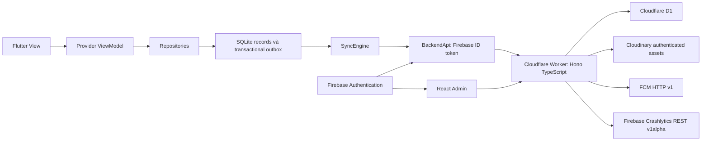

# Kiến trúc hệ thống sau triển khai backend

Ngày 13/11/2026. Firebase project được giữ nguyên: `longevity-plate-beff9`.

Flutter giữ Provider/ChangeNotifier, GoRouter và các interface Firebase cũ. Views không import Firebase SDK. `AppServices.connectedFirebase()` bật backend khi có `API_BASE_URL`. Khi không truyền define này, bản Firebase cũ vẫn dùng dữ liệu local và API PDF `REPORT_API_URL`; điều đó không chứng minh sync mới đã hoạt động.

Trong chế độ có backend, `LocalSyncStore` là nguồn dữ liệu nghiệp vụ trên máy. Một thay đổi và operation tương ứng ghi trong cùng transaction SQLite. SharedPreferences cũ được migrate theo UID đúng một lần và được giữ làm bản dự phòng. Repositories phát thông báo cho ViewModel khi cache thay đổi. SyncEngine gửi từng operation, sau đó xử lý ảnh và kéo change cursor.

Worker xác minh Firebase JWT, giới hạn tốc độ, suy ra UID từ token, kiểm tra Admin trong D1, rồi gọi các module records/media/notifications/providers. Chỉ server giữ Cloudinary API secret và service-account private key. File đi trực tiếp Flutter → Cloudinary; Worker xác minh metadata trước khi gắn file. Admin chỉ có Firebase Web SDK config công khai và ID token của phiên đăng nhập.

Worker phục vụ `admin/dist` bằng binding ASSETS. API được chạy qua Worker trước static assets. API PDF cũ `/reports/sign`, `/reports/url` vẫn được giữ. Scheduled handler mỗi 5 phút xử lý một số ít job cleanup/retry; không gửi campaign hàng loạt.

Code: `lib/services/sync/`, `lib/services/repositories.dart`, `lib/app/app_services.dart`, `server/src/`, `admin/src/`. Cấu hình chạy thật và giới hạn nghiệm thu: DEPLOYMENT_GUIDE.md, KNOWN_LIMITATIONS.md.
