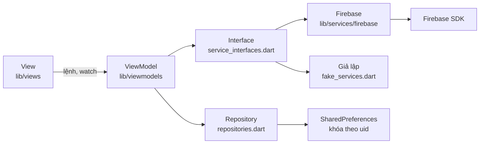

# Kiến trúc

App dùng MVVM với Provider. View không gọi Firebase SDK, chỉ `lib/services/firebase/` mới import các gói Firebase.

## Thư mục

| Thư mục | Vai trò |
|---|---|
| `lib/app` | Khởi tạo app, theme, router và guard, danh sách dịch vụ |
| `lib/core` | Ngày giờ, xử lý chữ, kiểm tra route thông báo |
| `lib/models`, `lib/data` | Model và nội dung minh họa |
| `lib/services` | Interface, repository, tạo PDF, bản giả lập |
| `lib/services/firebase` | Hiện thực cho 6 dịch vụ Firebase |
| `lib/viewmodels` | Trạng thái và logic từng màn |
| `lib/views` | Giao diện |

## Các quyết định chính

**Dữ liệu người dùng lưu local theo `uid`.** Đề yêu cầu 6 dịch vụ và không có Firestore. Nhật ký, kế hoạch, mục tiêu và lịch sử thông báo nằm trong SharedPreferences với khóa `<uid>.<tên>`. Cài lại app hoặc đổi thiết bị sẽ mất dữ liệu này.

**Vòng đời ViewModel gắn với màn.** Mỗi màn tạo ViewModel của mình bằng `ChangeNotifierProvider`. Đăng xuất làm guard chuyển về `/login`, shell và các màn bị hủy nên trạng thái trong bộ nhớ biến mất. `NotificationsViewModel` sống toàn app nên tự xóa danh sách khi `uid` đổi. Dữ liệu đã lưu theo `uid` vẫn còn để đăng nhập lại.

**Chặn truy cập tập trung ở một hàm.** `guardRedirect` trong [router.dart](../lib/app/router.dart) là hàm thuần, có test riêng, và chạy lại khi `SessionViewModel` thông báo thay đổi.

**Màn con nằm ngoài shell.** S05, S07, S09, S11, S12 không có bottom nav và được `push` để giữ nguyên trạng thái các tab. Nút Back dùng `maybePop` để `PopScope` được hỏi trước khi rời màn.

**Giả lập lỗi có kiểm soát.** Dữ liệu local hiếm khi lỗi thật, nên `FaultInjector` cho phép bật lỗi một lần từ Khu vực trình diễn. Lỗi đi qua đúng nhánh xử lý thật và "Thử lại" sẽ thành công.

## Sáu dịch vụ Firebase

| Dịch vụ | Interface | ViewModel dùng | Xử lý lỗi |
|---|---|---|---|
| Authentication + Google | `AuthService` | `SessionViewModel` | Phân biệt hủy, mất mạng, thiếu cấu hình. Hủy không ghi Crashlytics |
| Cloud Storage | `ReportStorageService` | `ReportViewModel`, `AccountViewModel` | Báo lỗi và có Thử lại. Giới hạn thử lại của SDK còn 30 giây |
| Cloud Messaging | `MessagingService` | `NotificationsViewModel` | Từ chối quyền có banner hướng dẫn. Route lạ về S12 |
| Analytics | `AnalyticsService` | Hầu hết ViewModel, router | Xem [analytics-plan.md](analytics-plan.md) |
| Crashlytics | `CrashService` | Mọi nhánh `catch` | Non-fatal kèm `reason`, user ID và custom key `route` |
| Remote Config | `RemoteConfigService` | `LibraryViewModel`, `PlannerViewModel` | Dùng giá trị đã lưu hoặc mặc định khi mất mạng |

## Remote Config

| Tham số | Kiểu | Mặc định | Tác dụng |
|---|---|---|---|
| `max_knowledge_results` | int | 3 | Số bài tối đa ở S08. Giá trị ≤ 0 bị bỏ qua và dùng mặc định |
| `suggested_recipes_enabled` | bool | true | Ẩn hoặc hiện mục "Món gợi ý" ở S06 |

Chu kỳ tải và lưu đệm:

1. Lúc mở app, `setDefaults` nạp mặc định trước nên app chạy được ngay mà không cần mạng.
2. `fetchAndActivate` chạy nền, không chặn khởi động. `minimumFetchInterval` là 0 ở bản debug để demo và 1 giờ ở bản khác để tránh bị giới hạn tần suất.
3. Trong khoảng thời gian đó SDK trả về giá trị đã lưu đệm thay vì gọi mạng.
4. `onConfigUpdated` nhận thay đổi từ Console khi app đang mở, nên hành vi đổi mà không cần build lại. Khu vực trình diễn có thêm nút "Tải lại cấu hình".
5. Mất mạng thì giữ giá trị đã kích hoạt gần nhất, chưa từng tải thì dùng mặc định.

## Cloud Messaging ở ba trạng thái app

| Trạng thái | Cách nhận | Kết quả |
|---|---|---|
| Foreground | `onMessage` | Lưu lịch sử, hiện SnackBar với nút "Xem" |
| Background | `onBackgroundMessage` ghi hàng chờ, `onMessageOpenedApp` khi chạm | Lưu lịch sử, điều hướng khi chạm |
| Terminated | `onBackgroundMessage`, `getInitialMessage` khi chạm mở app | Lưu lịch sử, điều hướng khi chạm |

Handler nền chạy ở isolate khác và chưa biết `uid`, nên ghi vào hàng chờ của thiết bị. Lần đọc tiếp theo chuyển tin vào lịch sử của người dùng đang đăng nhập và khử trùng theo `messageId`. Nếu chưa đăng nhập, tin được giữ lại và điều hướng sau khi đăng nhập xong.

Dữ liệu `route` đến từ bên ngoài nên phải qua `resolvePushRoute`. Chỉ các tab, S12, bài viết và công thức có thật mới được đi tới.

## Cloud Storage

Báo cáo PDF lưu tại `reports/{uid}/meal-report-<timestamp>.pdf`. [storage.rules](../firebase/storage.rules) chỉ cho chủ `uid` đọc và tạo tệp PDF dưới 5 MB, mọi đường dẫn khác bị từ chối.

Download URL có token nên ai có đường dẫn đều mở được, kể cả không qua rules. Đề yêu cầu hiển thị URL nên app giữ tính năng này. Không nên chia sẻ URL của báo cáo chứa dữ liệu thật.

## Giới hạn đã biết

- Dữ liệu không đồng bộ giữa các thiết bị.
- Không có server gửi FCM. Kiểm thử bằng công cụ gửi thử trên Firebase Console.
- `getToken()` đã bị đánh dấu deprecated ở `firebase_messaging` 17. App vẫn dùng vì form gửi thử cần registration token. Cần chuyển sang `register()` và `onRegistered` nếu có backend.
- Khu vực trình diễn hiện ở mọi bản build để phục vụ lab. Bản phát hành thật phải ẩn đi.
