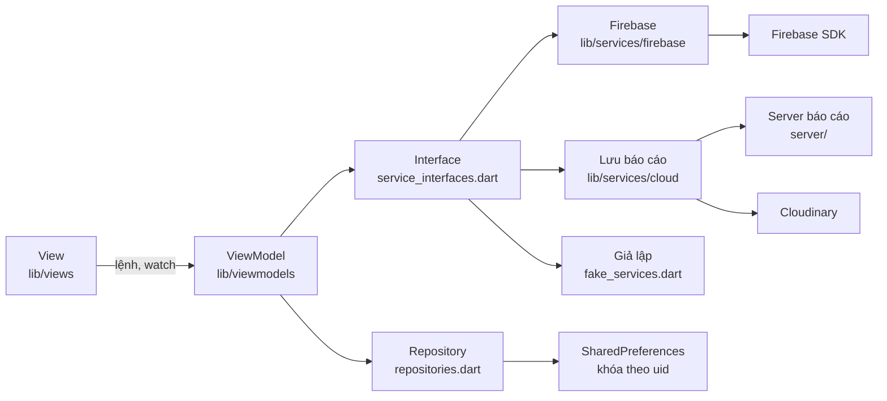
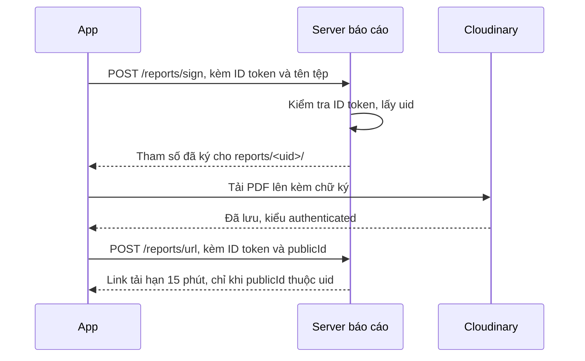

# Kiến trúc

App dùng MVVM với Provider. View không gọi Firebase SDK, chỉ `lib/services/firebase/` mới import các gói Firebase. Phần lưu báo cáo nằm ở `lib/services/cloud/`, gọi server báo cáo và Cloudinary qua HTTP.

## Thư mục

| Thư mục | Vai trò |
|---|---|
| `lib/app` | Khởi tạo app, theme, router và guard, danh sách dịch vụ |
| `lib/core` | Ngày giờ, xử lý chữ, kiểm tra route thông báo |
| `lib/models`, `lib/data` | Model và nội dung minh họa |
| `lib/services` | Interface, repository, tạo PDF, bản giả lập |
| `lib/services/firebase` | Hiện thực cho 5 dịch vụ Firebase |
| `lib/services/cloud` | Tải báo cáo lên Cloudinary qua server báo cáo |
| `server` | Server báo cáo chạy trên Cloudflare Workers, xem [server/README.md](../server/README.md) |
| `lib/viewmodels` | Trạng thái và logic từng màn |
| `lib/views` | Giao diện |

## Các quyết định chính

**Dữ liệu người dùng lưu local theo `uid`.** Đề yêu cầu 6 dịch vụ và không có Firestore. Nhật ký, kế hoạch, mục tiêu và lịch sử thông báo nằm trong SharedPreferences với khóa `<uid>.<tên>`. Cài lại app hoặc đổi thiết bị sẽ mất dữ liệu này.

**Vòng đời ViewModel gắn với màn.** Mỗi màn tạo ViewModel của mình bằng `ChangeNotifierProvider`. Đăng xuất làm guard chuyển về `/login`, shell và các màn bị hủy nên trạng thái trong bộ nhớ biến mất. `NotificationsViewModel` sống toàn app nên tự xóa danh sách khi `uid` đổi. Dữ liệu đã lưu theo `uid` vẫn còn để đăng nhập lại.

**Chặn truy cập tập trung ở một hàm.** `guardRedirect` trong [router.dart](../lib/app/router.dart) là hàm thuần, có test riêng, và chạy lại khi `SessionViewModel` thông báo thay đổi.

**Màn con nằm ngoài shell.** S05, S07, S09, S11, S12 không có bottom nav và được `push` để giữ nguyên trạng thái các tab. Nút Back dùng `maybePop` để `PopScope` được hỏi trước khi rời màn.

**Giả lập lỗi có kiểm soát.** Dữ liệu local hiếm khi lỗi thật, nên `FaultInjector` cho phép bật lỗi một lần từ Khu vực trình diễn. Lỗi đi qua đúng nhánh xử lý thật và "Thử lại" sẽ thành công.

## Sáu dịch vụ của đề

| Dịch vụ | Interface | ViewModel dùng | Xử lý lỗi |
|---|---|---|---|
| Authentication + Google | `AuthService` | `SessionViewModel` | Phân biệt hủy, mất mạng, thiếu cấu hình. Hủy không ghi Crashlytics |
| Lưu trữ tệp (Cloudinary thay Cloud Storage) | `ReportStorageService` | `ReportViewModel`, `AccountViewModel` | Báo lỗi và có Thử lại. Mỗi lần gọi mạng chờ tối đa 30 giây |
| Cloud Messaging | `MessagingService` | `NotificationsViewModel` | Từ chối quyền có banner hướng dẫn. Route lạ về S12 |
| Analytics | `AnalyticsService` | Hầu hết ViewModel, router | Xem [analytics-plan.md](analytics-plan.md) |
| Crashlytics | `CrashService` | Mọi nhánh `catch` | Non-fatal kèm `reason`, user ID và custom key `route` |
| Remote Config | `RemoteConfigService` | `LibraryViewModel`, `PlannerViewModel` | Dùng giá trị đã lưu hoặc mặc định khi mất mạng |

## Remote Config

| Tham số | Kiểu | Mặc định | Tác dụng |
|---|---|---|---|
| `max_knowledge_results` | int | 3 | Số bài tối đa ở S08. Giá trị ≤ 0 bị bỏ qua và dùng mặc định |
| `suggested_recipes_enabled` | bool | true | Ẩn hoặc hiện mục "Món gợi ý" ở S06 |

Chu kỳ tải và lưu đệm:

1. Lúc mở app, `setDefaults` nạp mặc định trước nên app chạy được ngay mà không cần mạng.
2. `fetchAndActivate` chạy nền, không chặn khởi động. `minimumFetchInterval` là 0 ở bản debug để demo và 1 giờ ở bản khác để tránh bị giới hạn tần suất.
3. Trong khoảng thời gian đó SDK trả về giá trị đã lưu đệm thay vì gọi mạng.
4. `onConfigUpdated` nhận thay đổi từ Console khi app đang mở, nên hành vi đổi mà không cần build lại. Khu vực trình diễn có thêm nút "Tải lại cấu hình".
5. Mất mạng thì giữ giá trị đã kích hoạt gần nhất, chưa từng tải thì dùng mặc định.

## Cloud Messaging ở ba trạng thái app

| Trạng thái | Cách nhận | Kết quả |
|---|---|---|
| Foreground | `onMessage` | Lưu lịch sử, hiện SnackBar với nút "Xem" |
| Background | `onBackgroundMessage` ghi hàng chờ, `onMessageOpenedApp` khi chạm | Lưu lịch sử, điều hướng khi chạm |
| Terminated | `onBackgroundMessage`, `getInitialMessage` khi chạm mở app | Lưu lịch sử, điều hướng khi chạm |

Handler nền chạy ở isolate khác và chưa biết `uid`, nên ghi vào hàng chờ của thiết bị. Lần đọc tiếp theo chuyển tin vào lịch sử của người dùng đang đăng nhập và khử trùng theo `messageId`. Nếu chưa đăng nhập, tin được giữ lại và điều hướng sau khi đăng nhập xong.

Dữ liệu `route` đến từ bên ngoài nên phải qua `resolvePushRoute`. Chỉ các tab, S12, bài viết và công thức có thật mới được đi tới.

## Lưu trữ báo cáo trên Cloudinary

Từ 03/02/2026, Firebase Cloud Storage cần gói Blaze, mà nhóm không có tài khoản thanh toán. Giảng viên cho phép thay bằng Cloudinary hoặc AWS S3, và nhóm chọn Cloudinary vì gói miễn phí không cần thẻ.

Cloudinary không biết ai đang đăng nhập Firebase. Vì vậy, một server nhỏ trong [server/](../server/README.md) giữ khóa bí mật của Cloudinary và kiểm tra quyền thay cho storage.rules. App không bao giờ có khóa bí mật này.

| Quy tắc trong storage.rules cũ | Nay nằm ở |
|---|---|
| Chỉ chủ `uid` được tạo tệp | Server chỉ ký cho `reports/<uid trong token>/`, không dùng uid do app gửi |
| Chỉ chủ `uid` được đọc | Tệp kiểu `authenticated` không mở được bằng đường dẫn thường. Server chỉ cấp link cho tệp của uid trong token, uid khác bị trả 403 |
| Chỉ nhận PDF | `allowed_formats=pdf` nằm trong chữ ký, Cloudinary đọc nội dung tệp để kiểm tra |
| Dưới 5 MB | Không có giới hạn riêng. Áp dụng giới hạn kích thước tệp của gói Cloudinary |
| Không ghi đè tệp cũ | `overwrite=false` nằm trong chữ ký |

Đề yêu cầu đưa `firebase/storage.rules` vào repo (trang 10). Vì đã bỏ Firebase Storage nên tệp đó cũng bỏ, và các quy tắc tương đương nằm trong [server/src/index.js](../server/src/index.js).

Tiến độ tải lên được tính theo số byte đã đưa cho http client, nên chỉ gần đúng với số byte đã đi qua mạng. Link tải hết hạn sau 15 phút. Muốn mở lại báo cáo sau thời gian đó thì phải xuất lại.

## Giới hạn đã biết

- Dữ liệu không đồng bộ giữa các thiết bị.
- Xuất báo cáo cần server báo cáo đang chạy. Server lỗi hoặc thiếu `REPORT_API_URL` khi build thì app báo lỗi và cho Thử lại.
- Không có server gửi FCM. Kiểm thử bằng công cụ gửi thử trên Firebase Console.
- `getToken()` đã bị đánh dấu deprecated ở `firebase_messaging` 17. App vẫn dùng vì form gửi thử cần registration token. Cần chuyển sang `register()` và `onRegistered` nếu có backend.
- Khu vực trình diễn hiện ở mọi bản build để phục vụ lab. Bản phát hành thật phải ẩn đi.
- Hàng chờ thông báo do handler nền ghi có thể mất tin nếu tin đến đúng lúc app đang chuyển hàng chờ sang lịch sử, vì SharedPreferences không có khóa giữa các isolate. Xem CR-02 trong [code-review.md](code-review.md).
