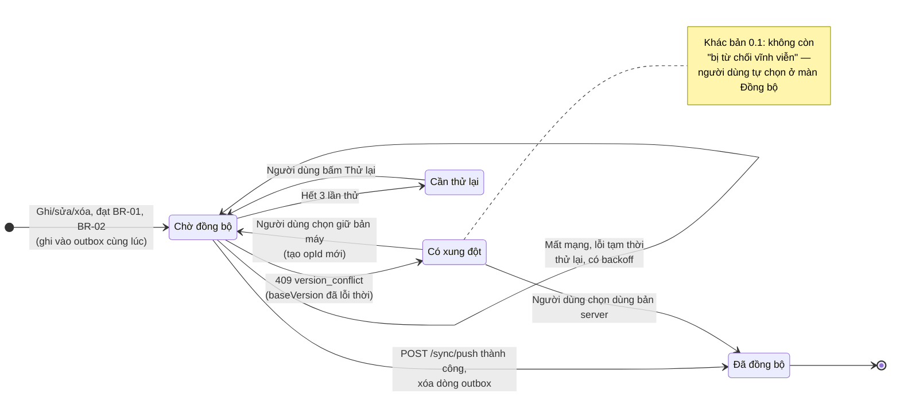
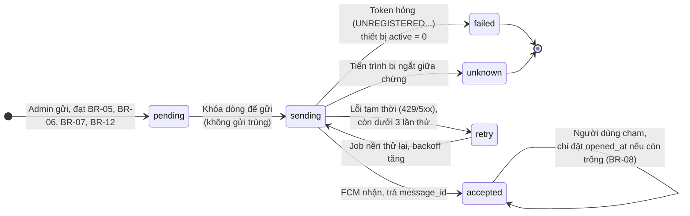
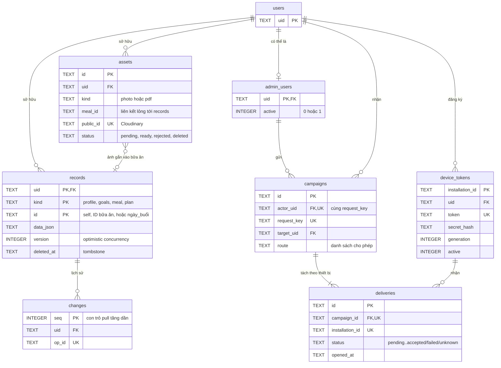
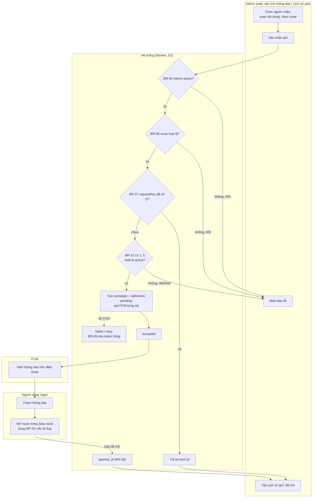
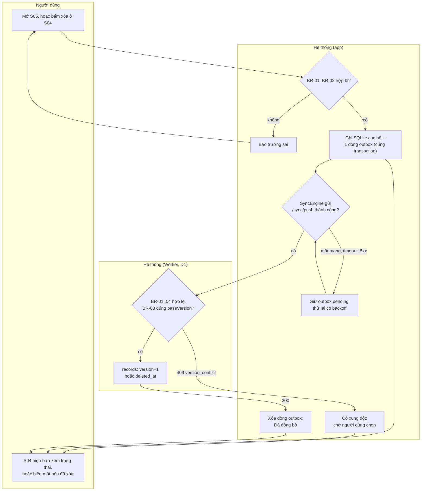
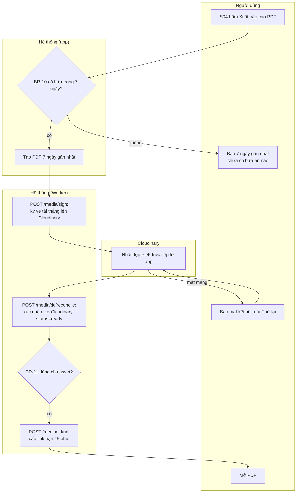

# Sơ đồ cho slide (sau PR #4)

Vẽ lại từ [api-contract.md](api-contract.md) (mục 3, 4) và [workflows.md](workflows.md) (mục 4–6), theo đúng code thật trên `main` sau PR #4. Sơ đồ nghiệp vụ tổng thể (slide 07) nằm ở mục 9 của workflows.md.

Xuất ảnh cho slide: dán từng khối vào https://mermaid.live rồi tải PNG hoặc SVG.

## 1. State machine bữa ăn trên máy (nhãn hiện ở S04)

## 2. State machine thông báo tới một thiết bị (`deliveries.status`)

## 3. ERD thật (12 bảng D1)

`admin_audit_logs`, `crash_snapshots`, `maintenance_jobs`, `rate_limits` không vẽ ở đây vì không thuộc 3 workflow demo — chi tiết ở mục 3 của api-contract.md.

## 4. Activity WF-01 · Gửi lời nhắc ăn uống

## 5. Activity WF-02 · Ghi nhận / xóa bữa ăn trong ngày

## 6. Activity WF-03 · Xuất báo cáo bữa ăn 7 ngày

Link quá 15 phút thì không mở được nữa, người dùng xin link mới qua `POST /media/:id/url`, không cần tạo lại PDF.
