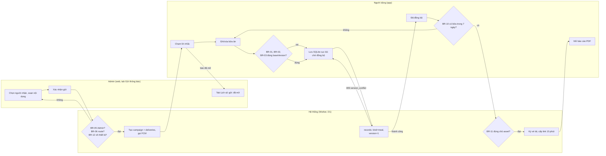

# Đặc tả workflow lõi (sau PR #4)

Phiên bản 0.2, 13/11/2026. Viết lại sau khi `main` có PR #4 (`feature/backend-admin-offline-sync`): cơ chế đồng bộ, thiết bị và thông báo đã đổi hẳn so với bản 0.1. Chi tiết API xem [api-contract.md](api-contract.md). Mục 10 ghi rõ chỗ nào trong bản cũ không còn đúng.

## 1. Danh sách workflow

Không đổi so với bản 0.1 — vẫn 3 workflow để demo, đã thống nhất với giảng viên qua khung Guideline:

| Mã | Tên | Actor |
|---|---|---|
| WF-01 | Gửi lời nhắc ăn uống | Admin (web), Hệ thống (Worker, D1), FCM, Người dùng (app) |
| WF-02 | Ghi nhận / xóa bữa ăn trong ngày | Người dùng, Hệ thống (app, SQLite cục bộ, Worker, D1) |
| WF-03 | Xuất báo cáo bữa ăn 7 ngày | Người dùng, Hệ thống (app, Worker), Cloudinary |

## 2. Kiểm tra nhanh 5 câu (W05)

Giữ nguyên kết luận bản 0.1 — cả 3 vẫn qua được 5 câu kiểm tra workflow (có trigger rõ, đi hết một vòng tới kết quả nghiệp vụ, đổi trạng thái, có rẽ nhánh theo business rule, có ít nhất một nhánh ngoại lệ). Đăng nhập, CRUD đơn thuần hay một màn hình riêng lẻ không tính là workflow, nên các màn Hồ sơ/Mục tiêu/Kế hoạch tuần không được liệt kê thành workflow riêng dù đã có API thật.

## 3. Mã dùng để truy vết

| Mã | Ý nghĩa |
|---|---|
| FR-01, FR-02 | Ghi, xóa bữa ăn |
| FR-03 | Admin gửi lời nhắc |
| FR-04 | App nhận và mở đúng màn từ thông báo |
| FR-05 | Báo "đã mở" lên server |
| FR-06 | Admin xem lịch sử gửi |
| FR-07, FR-08 | Tạo và tải báo cáo PDF 7 ngày |
| S03, S04, S05 | Hôm nay, Nhật ký bữa ăn, Thêm bữa ăn (app) |
| S10, S12 | Đăng nhập, Thông báo (app) |
| Admin / *tên tab* | 8 tab một trang trong `admin/src/App.tsx`: Tổng quan, Người dùng, Thiết bị, **Gửi thông báo**, **Lịch sử gửi**, Báo cáo PDF, Crashlytics, Nhật ký quản trị — không phải 3 màn URL riêng như bản 0.1 đặt tên AD01–AD03 |
| TC-S\* | Test tự động phía server, `server/test/api.spec.ts` (xem bảng mục 8 của api-contract.md) |
| TC-A\* | Test tự động phía app Flutter: `test/backend_api_test.dart`, `test/sync_engine_test.dart`, `test/sync_store_test.dart`, `test/notification_owner_test.dart`, `test/meal_delete_test.dart`, `test/firebase_features_test.dart` |
| TC-D\* | Ca chạy trên điện thoại thật, mục 7 |

## 4. WF-01 · Gửi lời nhắc ăn uống

| Trường | Nội dung |
|---|---|
| Mã & tên | WF-01 · Gửi lời nhắc ăn uống |
| Actor | Admin (web), Hệ thống (Worker, D1), FCM, Người dùng (app) |
| Trigger | Admin thấy cần nhắc một người dùng ghi bữa |
| Precondition | Admin có trong `admin_users`, `active = 1`. Người dùng đã đăng nhập app ít nhất một lần và còn thiết bị `active = 1` trong `device_tokens` |
| Postcondition | Có 1 dòng `campaigns` và mỗi thiết bị nhận 1 dòng `deliveries`. Thiết bị người dùng chạm vào có `opened_at`. Người dùng đang ở route trong `data.route` của thông báo |
| Truy vết | FR-03..06 · S05 (hoặc S12 nếu route lạ) · Admin tab "Gửi thông báo"/"Lịch sử gửi" · `NotificationsViewModel.open`, `POST /api/v1/admin/push`, `POST /api/v1/notifications/{id}/open` · TC-D01, TC-D02, TC-D07, nhóm `device lifecycle and FCM outcomes` trong `api.spec.ts` |

**Happy path**

| Bước | Actor | Việc làm |
|---|---|---|
| 1 | Admin | Đăng nhập web bằng Google, mở tab "Gửi thông báo" |
| 2 | Admin | Chọn người nhận (tab "Người dùng" hoặc gõ UID), nhập tiêu đề/nội dung, chọn route đích (mặc định `/log`), xác nhận gửi |
| 3 | Hệ thống (server) | `POST /admin/push`: kiểm Admin, route, chống gửi trùng theo `requestKey`; lấy tối đa 5 thiết bị `active`; tạo `campaigns`+`deliveries` ở `pending`; gọi FCM lần lượt, cập nhật `accepted`/`failed`/`retry` |
| 4 | FCM | Hiện thông báo trên điện thoại, kể cả khi app ở nền hoặc đã đóng |
| 5 | Người dùng | Chạm thông báo. App mở route trong `data.route`, gọi `POST /notifications/{id}/open` |
| 6 | Admin | Mở tab "Lịch sử gửi", thấy lượt vừa gửi đã `openedAt` |

**Điểm quyết định**

| Mã | Điều kiện | Nhánh không đạt | Test |
|---|---|---|---|
| BR-05 | Người gửi là Admin `active`? | 403 `admin_required`, không tạo gì | `does not let request payload elevate an admin role` |
| BR-06 | Route đích hợp lệ? | 400 `invalid_input` ngay khi Admin bấm gửi | `rejects arbitrary routes...` |
| BR-07 | Cùng `requestKey` đã gửi chưa? | Trả lại lượt cũ (200), không gọi FCM lần hai | `only admins send, retries with the same request key do not duplicate` |
| BR-12 | Người nhận có ≤ 5 thiết bị hoạt động? | > 5 thì 400 `recipient_limit_exceeded`; 0 thiết bị thì 409 `no_active_devices` | cùng nhóm test trên |
| BR-09 | FCM còn nhận token của thiết bị? | `failed`, thiết bị chuyển `active = 0`, lần sau không tính nữa | `invalid FCM tokens are deactivated, not marked delivered` |

**Exception**

- Người nhận không còn thiết bị hoạt động: 409 `no_active_devices`, web báo ngay khi Admin bấm gửi, không tạo `campaign` rỗng.
- Lỗi tạm thời khi gọi FCM (429/5xx): `deliveries` chuyển `retry`, job nền (`scheduled` trong `worker.ts`) tự gửi lại, tối đa 3 lần, có backoff tăng dần.
- Mất mạng lúc chạm thông báo: app vẫn mở đúng màn, chỉ là không gọi được `open`, Admin vẫn thấy `accepted` chứ chưa thấy `openedAt` (giới hạn đã biết, không có hàng đợi báo lại khi có mạng trở lại).
- Tiến trình server bị ngắt giữa lúc đang gọi FCM: `deliveries` chuyển `unknown` thay vì đoán là thành công hay thất bại (job nền dọn sau 5 phút).

## 5. WF-02 · Ghi nhận / xóa bữa ăn trong ngày

| Trường | Nội dung |
|---|---|
| Mã & tên | WF-02 · Ghi nhận / xóa bữa ăn trong ngày |
| Actor | Người dùng, Hệ thống (app: `MealRepository` + SQLite cục bộ + `SyncEngine`; Worker, D1) |
| Trigger | Người dùng vừa ăn xong một bữa, muốn xóa một bữa đã ghi nhầm, hoặc chạm lời nhắc ở WF-01 |
| Precondition | Đã đăng nhập (S10), đã chọn mục tiêu (S02) |
| Postcondition | Có 1 dòng `records` (`kind = 'meal'`) khớp nội dung trên máy; hiện "Đã đồng bộ". Nếu vừa xóa thì dòng đó có `deleted_at` trên server và biến mất khỏi S03/S04. Mất mạng thì vẫn hiện trên S03/S04 kèm "chờ đồng bộ" |
| Truy vết | FR-01, FR-02 · S03, S04, S05 · `MealRepository.add/delete`, `SyncEngine`, `LocalSyncStore`, `POST /api/v1/sync/push` · F02, TC-A14 (nay chạy qua `meal_delete_test.dart`), `D1 CRUD, revisions and synchronization` trong `api.spec.ts`, `sync_engine_test.dart`, `sync_store_test.dart`, TC-D03, TC-D04 |

**Happy path (ghi)**

| Bước | Actor | Việc làm |
|---|---|---|
| 1 | Người dùng | Mở S05 từ S04 hoặc từ lời nhắc; chọn ngày, loại bữa, nhập mô tả |
| 2 | Hệ thống (app) | Kiểm BR-01, BR-02; đạt thì ghi vào SQLite cục bộ (`local_records` + một dòng `outbox`) trong cùng transaction |
| 3 | Hệ thống (app) | `SyncEngine` gửi `POST /sync/push` với `opId`/`baseVersion` đã đóng băng lúc ghi |
| 4 | Hệ thống (server) | Kiểm lại BR-01..04, ghi vào `records`, trả bản ghi mới cho app |
| 5 | Hệ thống (app) | Xóa dòng `outbox` tương ứng; S03/S04 hiện "Đã đồng bộ" |

**Happy path (xóa, ở S04)**

| Bước | Actor | Việc làm |
|---|---|---|
| 1 | Người dùng | Bấm nút xóa trên một bữa, xác nhận hộp thoại |
| 2 | Hệ thống (app) | `MealRepository.delete` ghi tombstone vào SQLite cục bộ (`deleted = 1`) trong cùng transaction với dòng `outbox` xóa |
| 3 | Hệ thống (app) | `SyncEngine` gửi operation `deleted: true` qua `/sync/push` |
| 4 | Hệ thống (server) | Đặt `deleted_at`, dọn luôn ảnh đang chờ/đã có của bữa đó (`maintenance_jobs`) |
| 5 | Hệ thống (app) | Bữa biến mất khỏi S03/S04 ngay sau bước 2 (lạc quan), không chờ bước 3–4 |

**Điểm quyết định**

| Mã | Điều kiện | Nhánh không đạt | Test |
|---|---|---|---|
| BR-01, BR-02 | Mô tả 1–120 ký tự, loại bữa hợp lệ, ngày có thật? | Ở lại S05, chỉ ra trường sai, không ghi vào SQLite | `validates dates, enums, descriptions and cannot inject SQL` |
| BR-03 | Gửi lên server đúng `baseVersion` hiện tại? | Sai thì 409 `version_conflict`, app chuyển "Có xung đột", người dùng tự chọn giữ máy hay lấy server | `rejects concurrent stale edits while preserving the winning version` |
| BR-04 | Bữa thuộc đúng người đang đăng nhập? | Server trả 404 cho dữ liệu người khác | kiểm tra cách ly UID trong nhóm `D1 CRUD...` |

**Exception**

- Mất mạng hoặc server lỗi khi gửi: dòng `outbox` giữ `pending`, `SyncEngine` tự thử lại khi có thay đổi mới, khi mở lại app, hoặc khi quay lại từ nền; hết 3 lần thử liên tiếp mới chuyển `failed`.
- Ghi/xóa khi chưa từng đồng bộ (mất mạng từ đầu): hành động vẫn thành công trên máy ngay, không chặn người dùng chờ server.
- Hai thiết bị cùng sửa một bữa: thiết bị gửi sau thấy 409 `version_conflict`, màn Đồng bộ cho chọn giữ bản của mình (tạo `opId` mới với `baseVersion` hiện tại) hoặc dùng bản server (bỏ thao tác đang xung đột).
- Ảnh bữa ăn: tải lên qua `/api/v1/media/*` (mục 5.5 của api-contract.md), tối đa 3 lần thử, không đánh dấu "Đã đồng bộ" khi còn ảnh đang chờ tải.

## 6. WF-03 · Xuất báo cáo bữa ăn 7 ngày

| Trường | Nội dung |
|---|---|
| Mã & tên | WF-03 · Xuất báo cáo bữa ăn 7 ngày |
| Actor | Người dùng, Hệ thống (app, Worker), Cloudinary |
| Trigger | Cuối tuần, người dùng muốn xem lại cả tuần đã ăn gì |
| Precondition | Đã đăng nhập, có mạng, 7 ngày gần nhất có ít nhất 1 bữa (BR-10) |
| Postcondition | Có 1 dòng `assets` (`kind = 'pdf'`, `status = 'ready'`) trên Cloudinary; người dùng có link tải hạn 15 phút; bữa vừa ghi ở WF-02 có trong báo cáo |
| Truy vết | FR-07, FR-08 · S04 (bảng Xuất báo cáo PDF) · `ReportViewModel`, `ReportBuilder`, `ConnectedReportStorage`, `POST /api/v1/media/sign`, `POST /api/v1/media/{id}/reconcile`, `POST /api/v1/media/{id}/url` · nhóm `Cloudinary authorization and verified metadata` trong `api.spec.ts`, TC-D05, TC-D06 |

**Happy path**

| Bước | Actor | Việc làm |
|---|---|---|
| 1 | Người dùng | Ở S04 bấm Xuất báo cáo PDF, rồi bấm bắt đầu |
| 2 | Hệ thống (app) | Kiểm BR-10, lấy các bữa trong 7 ngày gần nhất, tạo PDF |
| 3 | Hệ thống (app → server) | `POST /media/sign` (kind `pdf`) xin vé tải thẳng lên Cloudinary |
| 4 | Cloudinary | Nhận tệp PDF trực tiếp từ app bằng vé đã ký |
| 5 | Hệ thống (app → server) | `POST /media/{id}/reconcile`: server hỏi lại Cloudinary, xác nhận kích thước/định dạng, chuyển `assets.status = ready` |
| 6 | Hệ thống (app → server) | `POST /media/{id}/url` lấy link hạn 15 phút; người dùng mở PDF |

**Điểm quyết định**

| Mã | Điều kiện | Nhánh không đạt | Test |
|---|---|---|---|
| BR-10 | Có ít nhất một bữa trong 7 ngày gần nhất? | Báo "7 ngày gần nhất chưa có bữa ăn nào", không gọi mạng | `firebase_features_test.dart`: *BR-10: 7 ngày gần nhất không có bữa nào thì không xuất báo cáo* |
| BR-11 | Người xin link là chủ sở hữu `asset`? | 404, không lộ file của người khác | `signs a stable owner namespace and cannot access another UID` |

**Exception**

- Mất mạng khi tải lên Cloudinary: báo mất kết nối, có nút Thử lại; vé ký (`/media/sign`) vẫn còn hạn 1 giờ nên không cần xin lại ngay.
- Phản hồi tải lên bị mất (ví dụ app bị tắt giữa chừng): gọi lại `reconcile` vẫn xác nhận đúng, không tạo file trùng (server hỏi thẳng Cloudinary bằng `public_id` xác định).
- Link quá 15 phút: không mở được nữa, người dùng xin link mới qua `/media/{id}/url` (không cần tạo lại PDF).

## 7. Ca chạy trên điện thoại thật

Chỉ chạy được khi đã deploy Worker và build app kèm `--dart-define=API_BASE_URL=<url>`. **Đội phải tự kiểm tra lại các ca này trước khi ghi vào minh chứng** — tài liệu `docs/DEVICE_ACCEPTANCE.md` do PR #4 tự viết đã ghi sẵn kết quả PASS, nhưng đó là tự báo cáo của bên viết code, chưa ai trong nhóm xác nhận lại trên máy.

| Mã | Workflow | Các bước | Kết quả mong đợi |
|---|---|---|---|
| TC-D01 | WF-01 | Admin gửi lời nhắc route `/log`, app đang ở nền; chạm vào thông báo | Mở Nhật ký; tab "Lịch sử gửi" hiện đã mở |
| TC-D02 | WF-01 | Đăng nhập web bằng tài khoản không phải Admin | Không gọi được route `/admin/*`, web báo lỗi |
| TC-D03 | WF-02 | Có mạng, ghi một bữa tối | S04 hiện "Đã đồng bộ"; D1 có dòng `records` tương ứng |
| TC-D04 | WF-02 | Tắt mạng, ghi một bữa; bật mạng, mở lại app | Lúc đầu "chờ đồng bộ", sau đó "Đã đồng bộ" |
| TC-D04b | WF-02 | Xóa một bữa đã đồng bộ | Biến mất khỏi S04 ngay; D1 có `deleted_at` sau khi có mạng |
| TC-D05 | WF-03 | Xuất báo cáo sau TC-D03 | Có tiến độ, link mở được PDF có bữa vừa ghi |
| TC-D06 | WF-03 | Tài khoản mới chưa có bữa nào, xuất báo cáo | Báo chưa có bữa, không tạo PDF, không gọi `/media/sign` |
| TC-D07 | WF-01 | Admin gửi lời nhắc khi app đã đóng hẳn; chạm vào | Mở app vào đúng route; tab "Lịch sử gửi" hiện đã mở |

Truy vấn D1 cho TC-D03 (thay tên database và UID):

```bash
npx wrangler d1 execute <tên-db> --remote --command "SELECT id, version, deleted_at, updated_at FROM records WHERE uid = '<UID>' AND kind = 'meal' ORDER BY updated_at DESC LIMIT 5"
```

## 8. Kịch bản demo (slide 17)

| Thứ tự | Workflow | Người thao tác | Kết quả để chỉ cho hội đồng |
|---|---|---|---|
| 01 | WF-01 Gửi lời nhắc | Admin trên web (tab "Gửi thông báo") | Điện thoại hiện lời nhắc; chạm vào mở Nhật ký |
| 02 | WF-02 Ghi và xóa bữa | Người dùng trên điện thoại | Bữa tối hiện "Đã đồng bộ"; xóa thử một bữa, biến mất ngay; tab "Lịch sử gửi" thấy lời nhắc đã mở |
| 03 | WF-03 Xuất báo cáo | Người dùng trên điện thoại | PDF có bữa tối vừa ghi |

Ngoại lệ chọn để demo, mỗi workflow một cái:
- WF-01: tài khoản không phải Admin không gọi được trang quản trị (TC-D02).
- WF-02: tắt mạng vẫn ghi/xóa được, bật mạng thì tự đồng bộ (TC-D04, TC-D04b).
- WF-03: tài khoản chưa có bữa nào không xuất được (TC-D06).

Chuẩn bị: tài khoản Admin và tài khoản người dùng demo, seed vài bữa trong 6 ngày trước (qua app, không qua D1 trực tiếp — PDF đọc dữ liệu từ máy, không đọc D1), script reset dữ liệu demo, video dự phòng, người thao tác khác người thuyết minh.

## 9. Sơ đồ nghiệp vụ tổng thể (slide 07)



Sơ đồ chỉ để vẽ lại cho slide. Nhánh "409 version_conflict" quay về "chờ đồng bộ" là đơn giản hóa — thực tế chuyển sang trạng thái "xung đột" riêng, người dùng tự chọn ở màn Đồng bộ (mục 5 của tài liệu này).

## 10. Khác với bản 0.1 (để không lẫn khi đọc tài liệu cũ hoặc slide đã lỡ làm theo bản cũ)

| Bản 0.1 (trước PR #4) | Thật tế (PR #4 trở đi) |
|---|---|
| Bảng `meals` riêng | Bảng `records` dùng chung cho profile/goals/meal/plan, lọc theo `kind` |
| Trạng thái bữa: pending/synced/**rejected** (vĩnh viễn) | pending/synced/**conflict** (người dùng tự xử lý, không vĩnh viễn)/failed |
| `PUT /api/v1/meals/{id}` app gọi trực tiếp | App chỉ gọi `/api/v1/sync/push` + `/api/v1/sync/pull`; route theo từng loại vẫn có nhưng app không dùng |
| Thiết bị đăng ký bằng `fcmToken` | Thêm `installationSecret` (hash) + `generation`, chống thiết bị khác mạo danh |
| `/reports/sign` + `/reports/url` | `/api/v1/media/sign` + `.../reconcile` + `.../url`; route cũ vẫn chạy nhưng app không gọi nữa khi đã bật `API_BASE_URL` |
| `REPORT_API_URL` (biến dart-define) | `API_BASE_URL` |
| Route cho phép có cả `/log/add` | Chỉ còn `/home`, `/log`, `/plan`, `/library`, `/notifications` (+ 2 dạng nested) — lời nhắc WF-01 dùng `/log` |
| Web Admin 3 màn AD01–AD03 | 1 trang, 8 tab |
| 6 bảng D1 | 12 bảng D1 (thêm records/changes/sync_operations/assets/admin_audit_logs/crash_snapshots/maintenance_jobs/rate_limits, bớt `meals` riêng) |
